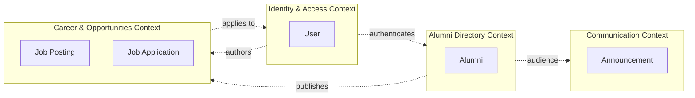
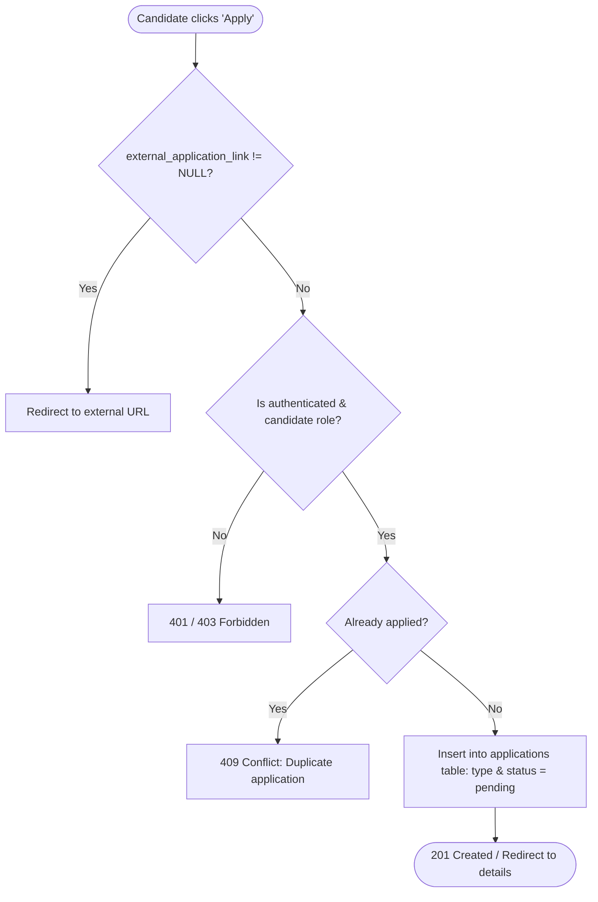

# Alumni — Domain-Driven Design

This document describes how Domain-Driven Design (DDD) concepts map onto the Node.js `Alumni` application and its Laravel counterpart. The physical data model is documented in [docs/ddd.md](docs/ddd.md).

## 1. Ubiquitous Language

| Term | Meaning |
|------|---------|
| **User** | An authenticated account holder: name, unique email, password hash, role (`student`, `alumni`, `admin`). |
| **Alumni** | A verified graduate: graduation year, department, current employer, job title, city, contact info. |
| **Announcement** | A public community notice (event, news, workshop) broadcasted to members. |
| **Job Posting** | An employment or internship opportunity published by an alumnus or admin. |
| **Job Application** | An internal application submitted by a candidate user to a specific job posting when no external link is provided. |
| **External Application Link** | A direct URL to an external corporate portal. If present, internal application submission is bypassed. |

## 2. Bounded Contexts

| Context | Responsibility | Aggregate root | Storage |
|---------|----------------|----------------|---------|
| **Identity & Access** | Account creation, authentication, password hashing, role management | `User` | `data/users.json` / MySQL `users` |
| **Alumni Directory** | Managing and querying alumni profile records | `Alumni` | PostgreSQL `alumni` / MySQL `profiles` |
| **Communication** | Publishing community news and notices | `Announcement` | PostgreSQL `announcements` / MySQL `announcements` |
| **Career & Opportunities** | Publishing job/internship postings and tracking candidate applications | `JobPosting` (with `JobApplication` entity) | PostgreSQL / MySQL `job_postings`, `job_applications` |

Each context owns its models, repositories, and controllers; contexts interact via defined interfaces rather than raw shared queries.

## 3. Entities & Aggregate Roots

| Entity | Role | File | Invariants & Rules |
|--------|------|------|--------------------|
| `User` | Aggregate Root | [models/userModel.js](models/userModel.js) | Unique email; `passwordHash` never exposed; Many-to-Many roles. |
| `Role` | Entity (Identity) | `app/Models/Role.php` | Unique machine name (`admin`, `alumni`, `company`, `student`). |
| `Company` | Entity (Directory/Career) | `app/Models/Company.php` | Registered company profile; One-to-Many job postings. |
| `Alumni` | Aggregate Root | [models/alumniModel.js](models/alumniModel.js) | Unique email; `graduationYear` between 1950 and 2100; computed `fullName`. |
| `Announcement` | Aggregate Root | [models/announcementModel.js](models/announcementModel.js) | Non-empty `title` and `content`. |
| `JobPosting` | Aggregate Root | `models/jobPostingModel.js` | Must have author (Alumni/Company/Admin); `employment_type` (full_time, part_time, internship, volunteer, project, contract); coordinates optional. |
| `Scholarship` | Aggregate Root | `app/Models/Scholarship.php` | Authored by alumni or admin; supports anonymous donor preference (`is_anonymous`), external foundation link or internal student applications. |
| `Application` | Entity within `JobPosting` / `Scholarship` | `app/Models/Application.php` | Candidate application for jobs, internships, volunteer projects, and scholarships; applicant can apply at most once per posting/scholarship; only permitted if `external_application_link` is NULL and posting is open. |

## 4. Layers and Folder Mapping

| DDD layer | Folders | Rule |
|-----------|---------|------|
| **Interface / Presentation** | `routes/`, `public/` | HTTP request routing, parameter parsing, HTML and JSON response delivery. No business rules. |
| **Application** | `controllers/` | Input validation, use-case coordination, status code translation (`200`, `201`, `204`, `400`, `404`, `409`). |
| **Domain** | `models/` | Core domain entities, business validation, aggregate invariant checks. |
| **Infrastructure** | `repositories/`, `config/`, `data/` | Database persistence (PostgreSQL / JSON), migration files, sample seeders. |

Dependency direction: `routes → controllers → models → repositories → config/db`.

## 5. Repository Pattern

- `userRepository`: Local JSON store with PBKDF2 hashing.
- `alumniRepository`: PostgreSQL with fallback memory store, filtering by department, year, city, search.
- `jobPostingRepository` & `jobApplicationRepository`: Parameterized queries managing `job_postings` and `job_applications` with automatic cascade and in-memory fallback.

## 6. Job Posting & Application Architecture

### 6.1 Hybrid Application Routing Logic
A posting supports two distinct application models:
1. **External Redirect**: If `external_application_link` is populated with a URL, candidates are forwarded directly to that external portal (e.g. LinkedIn, corporate career site). No database record is inserted into `applications`.
2. **Internal Application System**: If `external_application_link` is `NULL`, applicants submit their candidacy directly within the system for jobs, internships, or volunteer projects. Their data is tracked in the `applications` intermediate table.

### 6.2 Application Status Lifecycle
Internal applications transition through the following states:
- `pending` / `submitted`: Initial state upon submission.
- `reviewing`: Employer or HR is reviewing the profile and cover letter.
- `accepted`: Candidate is selected for interview / accepted for the role or project.
- `rejected`: Application was not selected.

### 6.3 Use Cases & Endpoints

| Use case | Endpoint | Method | Role | Success | Errors |
|----------|----------|--------|------|---------|--------|
| List postings | `/api/job-postings` | GET | Public | `200 OK` | `500` |
| View posting detail | `/api/job-postings/{id}` | GET | Public | `200 OK` | `404` |
| Create posting | `/api/job-postings` | POST | Alumni, Company, Admin | `201 Created` | `400`, `403` |
| Full update posting | `/api/job-postings/{id}` | PUT | Author, Admin | `200 OK` | `400`, `403`, `404` |
| Delete posting | `/api/job-postings/{id}` | DELETE | Author, Admin | `204 No Content` | `403`, `404` |
| List my applications (Direct) | `/api/my/applications` or `/my-applications` | GET | Candidate (Student/Alumni) | `200 OK` | `401` |
| Submit application (Nested) | `/api/jobs/{id}/applications` | POST | Candidate (Student/Alumni) | `201 Created` | `400`, `403`, `409` |
| List applicants for posting (Nested) | `/api/jobs/{id}/applications` | GET | Author, Admin | `200 OK` | `403`, `404` |
| Update application status (Nested) | `/api/jobs/{id}/applications/{appId}` | PATCH | Author, Admin | `200 OK` | `400`, `403`, `404` |
| Withdraw application | `/api/jobs/{id}/applications/{appId}` | DELETE | Candidate (while pending) | `204 No Content` | `403`, `404` |

## 7. Data Lifecycle & Migrations

- Node.js PostgreSQL migrations: `data/migrations/`
  - `001_create_alumni_table.js`: creates `alumni`
  - `002_create_job_postings_tables.js`: creates `job_postings` and `applications`
  - `003_create_scholarships_tables.js`: creates `scholarships` and links `applications`
- Laravel MySQL migrations: `database/migrations/`
  - `2026_10_21_000001_create_job_postings_table.php`: creates `job_postings`
  - `2026_10_21_000002_create_applications_table.php`: creates `applications`
  - `2026_10_21_000005_create_scholarships_table.php`: creates `scholarships`
  - `2026_10_21_000006_add_scholarship_id_to_applications_table.php`: adds `scholarship_id` foreign key

Running migrations and seeders:
- Node.js: `npm run migrate` / `npm run seed` / `npm run db:fresh`
- Laravel: `php artisan migrate --seed` (includes `ScholarshipSeeder` and `ApplicationSeeder`)

## 8. RESTful Route Architecture (Laravel)

### 8.1 Direct Resources
| Resource | URI Pattern | Name Prefix | Controller / Action |
|----------|-------------|-------------|---------------------|
| Jobs / Postings | `/jobs`, `/job-postings` | `job-postings.*`, `jobs.*` | `JobPostingController` |
| Scholarships | `/scholarships` | `scholarships.*` | `ScholarshipController` |
| My Applications (Direct) | `/my-applications`, `/my/applications` | `my-applications`, `my.applications` | Closure / `JobApplicationController` |
| Announcements | `/announcements` | `announcements.*` | `AnnouncementController` |
| Social Feed | `/feed-posts` | `feed-posts.*` | `FeedPostController` |
| Work Experiences | `/work-experiences` | `work-experiences.*` | `WorkExperienceController` |
| Companies | `/api/companies` | `api.companies.*` | `CompanyController` |
| Alumni Directory | `/api/alumni` | `api.alumni.*` | `AlumniController` |

### 8.2 Nested Resources (Hiyerarşik / İlişkili Rotalar)
| Relationship | Nested URI Pattern | Route Name | Purpose |
|--------------|-------------------|------------|---------|
| Job → Applications | `/jobs/{job}/applications` | `jobs.applications.index` | Bir ilana ait başvuruları listeleme (Yayıncı / Admin) |
| Job → Apply | `/jobs/{job}/apply` or `POST /jobs/{job}/applications` | `jobs.apply`, `jobs.applications.store` | Adayın ilana dahili başvuruda bulunması |
| Job → Application | `/jobs/{job}/applications/{app}` | `jobs.applications.update` | Başvuru durumunu (`pending`, `reviewing`, `accepted`, `rejected`) güncelleme |
| Job → Withdraw | `/jobs/{job}/applications/{app}` | `jobs.applications.destroy` | Başvuruyu geri çekme / silme |
| Scholarship → Apply | `/scholarships/{scholarship}/apply` | `scholarships.apply` | Öğrencinin bursa dahili başvuruda bulunması |
| Scholarship → Applications | `/scholarships/{scholarship}/applications` | `scholarships.applications.index` | Burs veren mezunun aday öğrencileri incelemesi |
| Company → Jobs | `/companies/{company}/jobs` | `companies.jobs.index` | Belirli bir şirkete ait ilanları listeleme |
| Alumnus → Experiences | `/alumni/{user}/experiences` | `alumni.experiences.index` | Belirli bir mezunun kariyer geçmişini listeleme |

### 8.3 Role-Based Middleware Groups
| Group | Middleware | Permitted Roles | Actions Allowed |
|-------|------------|-----------------|-----------------|
| Public | `web` / `api` | All / Guests | Listing & viewing public postings, scholarships, announcements |
| Candidate | `auth`, `role:student,alumni,admin` | Student, Alumni, Admin | Submitting job/scholarship applications, viewing personal applications (`/my-applications`) |
| Publisher | `auth`, `role:alumni,company,admin` | Alumni, Company, Admin | Creating & updating job postings, funding scholarships, reviewing applicants |
| System Admin | `auth`, `role:admin` | Admin | Full platform settings, role assignments, company and grant approvals |
