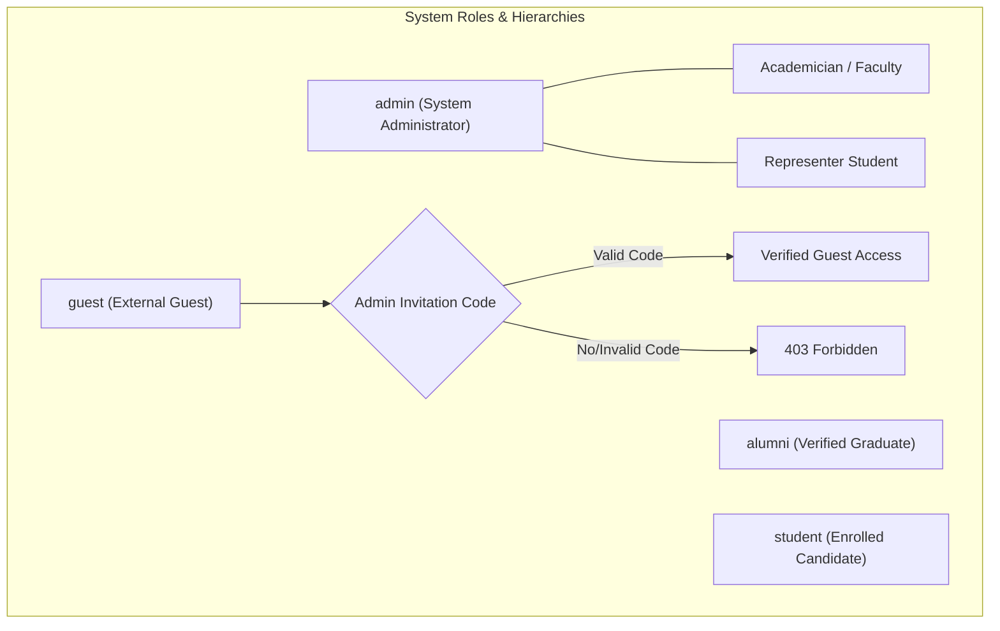
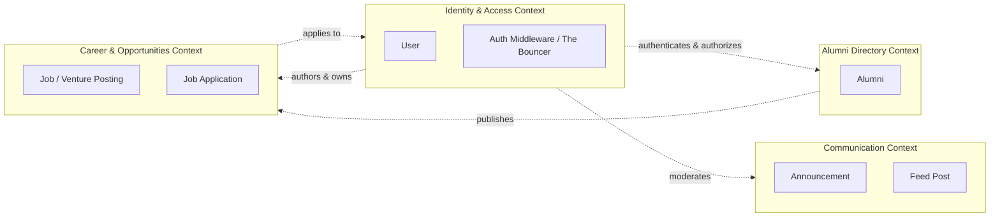
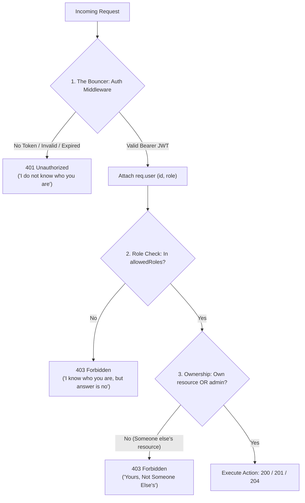

# Alumni — Domain-Driven Design & Security Architecture

This document describes how Domain-Driven Design (DDD) concepts map onto the Node.js `Alumni` application and its Laravel counterpart, along with the foundational **Authentication, Authorization & Security Principles**. The physical data model is documented in [docs/ddd.md](docs/ddd.md).

---

## 1. Ubiquitous Language

| Term | Meaning |
|------|---------|
| **User** | An authenticated account holder: name, unique email, password hash, role (`student`, `alumni`, `admin`, `guest`). |
| **Alumni (Graduate)** | A verified university graduate: graduation year, department, current employer, job title, city, and verified mentor status. |
| **Student** | An enrolled university student seeking career mentorship, internship opportunities, and alumni connections. |
| **Admin** | An administrative authority with two institutional branches: **Academician** (faculty/department head) and **Representer Student** (student council/community coordinator). |
| **Guest** | An external guest user. Requires a verified **Admin Invitation Code** to register or access private community data. |
| **Announcement** | A public or community notice (official academic calendar, summit, workshop) broadcasted by Administrators. |
| **Job / Venture Posting** | An employment, internship, startup opportunity, or project notice published by an alumnus or admin. |
| **Job Application** | An internal application submitted by a student or alumni candidate when no external application link is provided. |
| **External Application Link** | A direct URL to an external corporate portal. If present, internal application submission is bypassed. |

### 1.1 Roles & Actor Definitions (RBAC)

| Role | Machine Name | Scope & Authority Boundaries |
|:-----|:-------------|:------------------------------|
| **Student** | `student` | Candidate member. Can view public feeds and jobs, apply to internal postings/scholarships (`JobApplication`), request mentorship, and comment on feed posts. |
| **Alumni** | `alumni` | Verified graduate. Can publish job/internship opportunities, share Career Step & Venture posts, offer mentorship, review applicant candidacies, and bookmark posts. |
| **Admin** | `admin` | Comprehensive platform administrator covering two roles: 1. **Academician (Faculty / Department Rep):** Official institutional announcements, academic schedules, and formal mentorship matching. 2. **Representer Student:** Student body coordination, club activities, and campus summit initiatives. Has full moderation and bypass ownership powers. |
| **Guest** | `guest` | External applicant/observer. **Mandatory Rule:** Must possess and validate an **Admin Invitation Code (`invitation_code`)** issued by an `admin` to register or unlock private alumni directory features. |

---

## 2. Bounded Contexts

| Context | Responsibility | Aggregate Root | Storage |
|---------|----------------|----------------|---------|
| **Identity & Access** | Account registration, salt+hash password storage, token generation, role verification, invitation code gate | `User` | `data/users.json` / MySQL `users` |
| **Alumni Directory** | Managing and querying verified alumni records, company histories, mentorship status | `Alumni` | PostgreSQL `alumni` / MySQL `profiles` |
| **Communication** | Publishing community news, official academic notices, dynamic feeds, comments | `Announcement`, `FeedPost` | PostgreSQL / JSON `announcements`, `feed.json` |
| **Career & Opportunities** | Job/internship postings, venture announcements, candidate application workflows | `JobPosting` (with `JobApplication` entity) | PostgreSQL / MySQL `job_postings`, `job_applications` |

---

## 3. Entities & Aggregate Roots

| Entity | Role | File | Invariants & Rules |
|--------|------|------|--------------------|
| `User` | Aggregate Root | [models/userModel.js](models/userModel.js) | Unique email; `passwordHash` never exposed in responses; roles restricted to (`student`, `alumni`, `admin`, `guest`). |
| `Role` | Entity (Identity) | `app/Models/Role.php` | Unique machine name (`admin`, `alumni`, `student`, `guest`). |
| `Alumni` | Aggregate Root | [models/alumniModel.js](models/alumniModel.js) | Unique email; `graduationYear` between 1950 and 2100; computed `fullName`. |
| `Announcement` | Aggregate Root | [models/announcementModel.js](models/announcementModel.js) | Non-empty `title` and `content`; authored only by `admin` (Academician/Representer). |
| `JobPosting` | Aggregate Root | `models/jobPostingModel.js` | Authored by `Alumni` or `Admin`; supports `employment_type` (full-time, part-time, internship, contract). |
| `Application` | Entity within `JobPosting` / `Scholarship` | `app/Models/Application.php` | Candidate application; applicant can apply at most once per posting; only permitted if `external_application_link` is NULL and posting is active. |

---

## 4. Layers and Folder Mapping

| DDD Layer | Folders | Rule |
|-----------|---------|------|
| **Interface / Presentation** | `routes/`, `public/` | HTTP request routing, parameter parsing, HTML and JSON response delivery. No business rules. |
| **Application** | `controllers/`, `middlewares/` | Input validation, auth enforcement, use-case coordination, status translation (`200`, `201`, `204`, `400`, `401`, `403`, `404`, `409`). |
| **Domain** | `models/` | Core domain entities, business validation, aggregate invariant checks. |
| **Infrastructure** | `repositories/`, `config/`, `data/` | Database persistence (PostgreSQL / JSON), migration files, sample seeders. |

Dependency direction: `routes → middlewares → controllers → models → repositories → config/db`.

---

## 5. Authentication, Authorization & Security Architecture

### 5.1 Password Storage & Login (`POST /api/login`)
1. **Password Storage Rule:** Passwords must never be stored in plaintext.
2. **Salt + Hash:** Each user record must generate a unique cryptographic salt. Password hashing must apply strong one-way hashing (e.g. bcrypt `$2b$12$...` or PBKDF2). Two identical passwords across different accounts produce completely distinct hashes.
3. **Login Logic (IF / ELSE):**
   - `IF` incoming `email` and `password` match an existing record:
     - Generate an authenticated token (JWT) embedding `userId` and `role`.
     - Return `200 OK` with the token.
   - `ELSE` (`email` does not exist OR `password` does not match):
     - Return a generic **`401 Unauthorized`** response without revealing whether the email or password was wrong (*Information Leakage Prevention*).

### 5.2 The Bouncer: Authentication Middleware (`401 Guard`)
For every protected endpoint:
- **STEP 1:** Inspect the request and extract the `Authorization: Bearer <token>` header.
- `IF` token is missing, malformed, or expired:
  - Halt request execution before reaching the route handler.
  - Return **`401 Unauthorized`** (*"I do not know who you are"*).
- `ELSE` (token is valid):
  - Extract the verified payload and attach it to the request: `req.user = { id, role }`.
  - Pass control to the route handler via `next()`.

### 5.3 Role & Ownership Enforcement (`403 Guard`)

#### A. Role Verification ("Who May Do What")
- `IF` `req.user.role` is not present in the route's `allowedRoles` list:
  - Return **`403 Forbidden`** (*"I know who you are, and the answer is no"*).
  - *Example:* A user with role `student` attempting `POST /api/job-postings` receives `403`.

#### B. Resource Ownership Verification ("Yours, Not Someone Else's")
- **Trust Rule:** Never trust user ID fields supplied in the request body (`req.body.userId`). Always establish identity from verified `req.user.id`.
- `IF` a non-admin user attempts to mutate or delete a resource authored by another member (e.g. Graduate A attempting to edit Graduate B's job posting or profile):
  - Return **`403 Forbidden`** (*"Cannot modify a resource belonging to another member"*).
- `ELSE` (the resource belongs to `req.user.id` OR `req.user.role === 'admin'`):
  - Execute the requested operation and return the appropriate HTTP code (`200 OK` / `204 No Content`).

### 5.4 Guest Access Code Gate
- The `guest` role is restricted from open browsing of private directory records.
- To register or elevate permissions, a guest must supply a valid `invitation_code` issued by an `admin`:
  - `IF` `guest` provides no invitation code or an invalid code:
    - Return **`403 Forbidden`** (*"Guest access requires a valid invitation code from an Admin"*).

---

## 6. Job & Opportunity Architecture

### 6.1 Hybrid Application Routing Logic
1. **External Redirect**: If `external_application_link` contains a URL, candidates are forwarded directly to that portal. No internal record is created.
2. **Internal Application System**: If `external_application_link` is `NULL`, applicants submit their candidacy directly within the system.

### 6.2 Application Lifecycle States
- `pending` / `submitted`: Initial state upon candidate submission.
- `reviewing`: Alumnus publisher is reviewing the application.
- `accepted`: Candidate selected for interview or opportunity.
- `rejected`: Application was not selected.

### 6.3 Use Cases & Endpoints (with Security Codes)

| Use Case | Endpoint | Method | Permitted Role | Success | Auth Errors |
|:---------|:---------|:-------|:---------------|:--------|:------------|
| List postings | `/api/job-postings` | GET | Public / Guest (with code) | `200 OK` | - |
| View posting detail | `/api/job-postings/{id}` | GET | Public / Guest | `200 OK` | `404` |
| Create posting | `/api/job-postings` | POST | Alumni, Admin | `201 Created` | `401`, `403` |
| Full update posting | `/api/job-postings/{id}` | PUT | Author (Alumni), Admin | `200 OK` | `401`, `403`, `404` |
| Delete posting | `/api/job-postings/{id}` | DELETE | Author (Alumni), Admin | `204 No Content` | `401`, `403`, `404` |
| List my applications | `/api/my/applications` | GET | Candidate (Student, Alumni) | `200 OK` | `401` |
| Submit application | `/api/jobs/{id}/applications` | POST | Candidate (Student, Alumni) | `201 Created` | `401`, `403`, `409` |
| List applicants for posting | `/api/jobs/{id}/applications` | GET | Author (Alumni), Admin | `200 OK` | `401`, `403`, `404` |
| Update application status | `/api/jobs/{id}/applications/{appId}` | PATCH | Author (Alumni), Admin | `200 OK` | `401`, `403`, `404` |
| Withdraw application | `/api/jobs/{id}/applications/{appId}` | DELETE | Candidate (Self) | `204 No Content` | `401`, `403`, `404` |

---

## 7. Role-Based Middleware Groups (REST Architecture)

| Group | Middleware Stack | Permitted Roles | Actions Allowed |
|:------|:-----------------|:----------------|:----------------|
| **Public** | `web` / `api` | All / Public | Browsing public feed, view non-confidential announcements |
| **Guest Gated** | `auth:guest`, `code:verify` | Guest (with Admin Code) | Entering portal, viewing restricted alumni index |
| **Candidate** | `auth`, `role:student,alumni,admin` | Student, Alumni, Admin | Submitting job/internship applications, managing `/my-applications` |
| **Publisher** | `auth`, `role:alumni,admin` | Alumni, Admin | Creating & updating job opportunities, venture notices, candidate review |
| **System Admin** | `auth`, `role:admin` | Admin (Academician & Representer) | Full institutional announcements, invitation code generation, ownership bypass |
