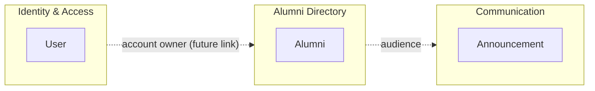

# Alumni — Domain-Driven Design

This document describes how Domain-Driven Design (DDD) concepts map onto the Node.js `Alumni` application. The physical data model is documented in [docs/ddd.md](docs/ddd.md).

## 1. Ubiquitous Language

| Term | Meaning |
|------|---------|
| **User** | An account holder: name, unique email, password hash. |
| **Alumni** | A graduate: graduation year, department, employer, job title, city, contact details. |
| **Announcement** | A notice (event, career opportunity) addressed to the alumni community. |
| **Graduation year / Department** | The main attributes for grouping and filtering alumni. |

## 2. Bounded Contexts

| Context | Responsibility | Aggregate root | Storage |
|---------|----------------|----------------|---------|
| Identity & Access | Account creation, password hashing, email uniqueness | `User` | `data/users.json` |
| Alumni Directory | Managing and querying alumni records | `Alumni` | PostgreSQL `alumni` (in-memory fallback) |
| Communication | Publishing announcements | `Announcement` | PostgreSQL `announcements` (in-memory fallback) |

Each context owns its model, repository, controller and routes; contexts do not read each other's storage.

## 3. Entities

| Entity | File | Identity and invariants |
|--------|------|-------------------------|
| `User` | [models/userModel.js](models/userModel.js) | `id`; unique email; `passwordHash` is never serialized |
| `Alumni` | [models/alumniModel.js](models/alumniModel.js) | `id`; unique email; `graduationYear` 1950–2100; derived `fullName` |
| `Announcement` | [models/announcementModel.js](models/announcementModel.js) | `id`; non-empty `title` and `content` |

Email, graduation year and full name behave as value objects (no identity, validated by value) but are not modelled as separate classes.

## 4. Layers and Folder Mapping

| DDD layer | Folders | Rule |
|-----------|---------|------|
| Interface | `routes/`, `public/` | Routing and static views only; no business rules |
| Application | `controllers/` | Validates input, invokes the model, maps results to HTTP status codes |
| Domain | `models/` | Entities and business rules |
| Infrastructure | `repositories/`, `config/`, `data/` | SQL and file access, schema migrations, seeders |

Dependency direction: `routes → controllers → models → repositories → config/db`.

## 5. Repository Pattern

- `userRepository`: JSON file store (`findAll`, `findById`, `findByEmail`, `create`, `update`, `delete`) with PBKDF2 hashing.
- `alumniRepository`: parameterized PostgreSQL queries with in-memory fallback; `findAll(filters)` supports department, graduation year, city and free-text search.
- Controllers never contain SQL, so the storage engine can change without touching them.

Known gap: `announcementModel.js` issues SQL directly; an `announcementRepository` should be extracted for full alignment.

## 6. Alumni Use Cases

| Use case | Endpoint | Success | Errors |
|----------|----------|---------|--------|
| List / filter | `GET /api/alumni?department=&graduationYear=&city=&search=` | 200 | 500 |
| Get | `GET /api/alumni/{id}` | 200 | 404 |
| Create | `POST /api/alumni` | 201 | 400, 409 |
| Replace | `PUT /api/alumni/{id}` | 200 | 400, 404, 409 |
| Update | `PATCH /api/alumni/{id}` | 200 | 400, 404, 409 |
| Delete | `DELETE /api/alumni/{id}` | 204 | 404 |

## 7. Data Lifecycle

`npm run migrate` → `npm run seed` → `npm run db:fresh`. Sources: `data/migrations/`, `data/factories/alumniFactory.js` (deterministic fake data), `data/seeders/alumniSeeder.js`.

## 8. Laravel Counterpart

[`../AlumniLaravel`](../AlumniLaravel/) implements the same domain: `app/Models` (entities), `app/Http/Controllers` (application), `routes/web.php` (interface), `database/` (migrations, factories, seeders). Eloquent combines the repository and active-record roles.
