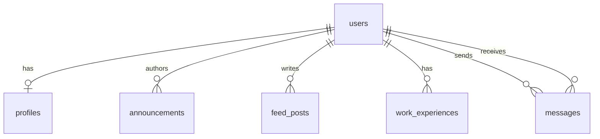

# Data Design Documentation

Physical data model of the Alumni Tracking System. It covers both implementations:

- **Laravel app** (`AlumniLaravel/`): MySQL 8, InnoDB, managed by migrations in `database/migrations`.
- **Node.js app** (`Alumni/`): PostgreSQL 16 plus a JSON user store, managed by `data/migrations` and `config/db.js`.

Primary keys are auto-increment integers. Laravel tables carry `created_at` / `updated_at`.

---

## 1. Laravel / MySQL Schema

All foreign keys use `ON DELETE CASCADE`.

### 1.1 `users`
| Column | Type | Constraints |
|--------|------|-------------|
| `id` | BIGINT UNSIGNED | PK |
| `name` | VARCHAR(255) | NOT NULL |
| `email` | VARCHAR(255) | NOT NULL, UNIQUE |
| `email_verified_at` | TIMESTAMP | NULL |
| `password` | VARCHAR(255) | NOT NULL (hashed) |
| `role` | ENUM('student','alumni','admin') | NOT NULL, default `student`, indexed |
| `remember_token` | VARCHAR(100) | NULL |

Framework tables: `password_reset_tokens`, `sessions`, `cache`, `jobs`.

### 1.2 `profiles`
| Column | Type | Constraints |
|--------|------|-------------|
| `id` | BIGINT UNSIGNED | PK |
| `user_id` | BIGINT UNSIGNED | FK → `users.id`, UNIQUE (one profile per user) |
| `graduation_year` | INT | NOT NULL |
| `department` | VARCHAR(255) | NOT NULL |
| `bio` | TEXT | NULL |

### 1.3 `announcements`
| Column | Type | Constraints |
|--------|------|-------------|
| `id` | BIGINT UNSIGNED | PK |
| `user_id` | BIGINT UNSIGNED | FK → `users.id`; validated to be an `alumni` user |
| `title` | VARCHAR(255) | NOT NULL |
| `content` | TEXT | NOT NULL |
| `company_name` | VARCHAR(255) | NULL |

### 1.4 `feed_posts`
| Column | Type | Constraints |
|--------|------|-------------|
| `id` | BIGINT UNSIGNED | PK |
| `user_id` | BIGINT UNSIGNED | FK → `users.id` |
| `body` | TEXT | NOT NULL (validated 2–5000 characters) |
| `image_path` | VARCHAR(255) | NULL (validated as URL) |

### 1.5 `work_experiences`
| Column | Type | Constraints |
|--------|------|-------------|
| `id` | BIGINT UNSIGNED | PK |
| `user_id` | BIGINT UNSIGNED | FK → `users.id` |
| `company` | VARCHAR(255) | NOT NULL |
| `position` | VARCHAR(255) | NOT NULL |
| `latitude` | DECIMAL(10,8) | NOT NULL (−90 to 90) |
| `longitude` | DECIMAL(11,8) | NOT NULL (−180 to 180) |

### 1.6 `messages`
| Column | Type | Constraints |
|--------|------|-------------|
| `id` | BIGINT UNSIGNED | PK |
| `sender_id` | BIGINT UNSIGNED | FK → `users.id` |
| `receiver_id` | BIGINT UNSIGNED | FK → `users.id` |
| `content` | TEXT | NOT NULL |
| `read_at` | TIMESTAMP | NULL (unread when NULL) |

Index: `(receiver_id, read_at)` for unread-message lookups.

### 1.7 Business rules
| Rule | Enforced by |
|------|-------------|
| Only `alumni` users may author announcements | `AnnouncementController` validation (`Rule::exists('users','id')->where('role','alumni')`) |
| One profile per user | UNIQUE `profiles.user_id` |
| Coordinates stay within valid ranges and precision | `WorkExperienceController` validation |
| Deleting a user removes all dependent rows | Foreign key `CASCADE` |

### 1.8 Seed data
`DatabaseSeeder` creates 50 users (admin `admin@alumni.test`, at least 10 alumni), one profile per user, 1–3 work experiences per user, 1–3 announcements per alumni, 0–4 feed posts per user and 120 messages (`tr_TR` Faker locale).

---

## 2. Node.js / PostgreSQL Schema

### 2.1 `alumni` (`data/migrations/001_create_alumni_table.js`)
| Column | Type | Constraints |
|--------|------|-------------|
| `id` | SERIAL | PK |
| `first_name` | VARCHAR(100) | NOT NULL |
| `last_name` | VARCHAR(100) | NOT NULL |
| `email` | VARCHAR(255) | NOT NULL, UNIQUE |
| `phone` | VARCHAR(30) | NULL |
| `graduation_year` | SMALLINT | NOT NULL, CHECK 1950–2100 |
| `department` | VARCHAR(150) | NOT NULL |
| `current_company` | VARCHAR(150) | NULL |
| `job_title` | VARCHAR(150) | NULL |
| `city` | VARCHAR(100) | NULL |
| `linkedin_url` | VARCHAR(255) | NULL |
| `created_at` | TIMESTAMPTZ | NOT NULL, default `NOW()` |
| `updated_at` | TIMESTAMPTZ | NULL |

Indexes: `idx_alumni_graduation_year`, `idx_alumni_department`.

### 2.2 `announcements` (created in `config/db.js`)
| Column | Type | Constraints |
|--------|------|-------------|
| `id` | SERIAL | PK |
| `title` | VARCHAR(255) | NOT NULL |
| `content` | TEXT | NOT NULL |
| `created_at` | TIMESTAMPTZ | default `NOW()` |
| `updated_at` | TIMESTAMPTZ | NULL |

Two sample announcements are inserted when the table is empty.

### 2.3 Users (`data/users.json`)
JSON array of `{ id, name, email, passwordHash, createdAt, updatedAt? }`. `passwordHash` is `salt:hash` (PBKDF2-SHA512, 1000 iterations); it is never returned by the API.

### 2.4 Sample data
`data/seeders/alumniSeeder.js` inserts 3 fixed alumni plus 12 generated by `data/factories/alumniFactory.js` (deterministic, Turkish names/companies). Inserts use `ON CONFLICT (email) DO NOTHING`, so seeding is repeatable.

---

## 3. Naming and Conventions
- Tables: plural `snake_case`; foreign keys: `<singular>_id`.
- API fields are `camelCase` (`graduationYear`); the repository maps them to `snake_case` columns.
- Passwords are stored only as salted hashes.
