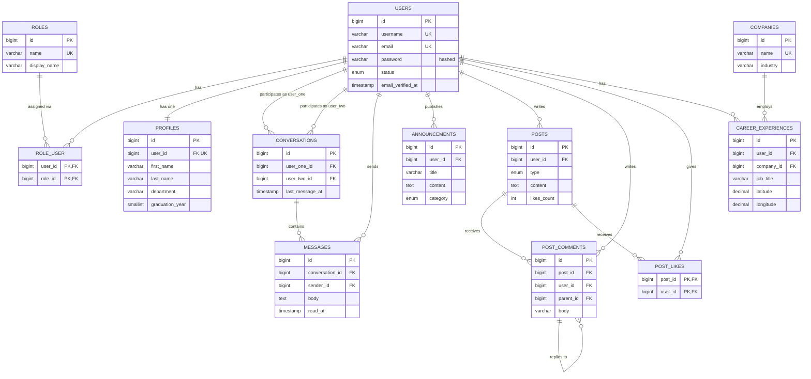

# Alumni & Student Network — Data Design Documentation

| | |
|---|---|
| **Project** | Alumni & Student Network |
| **Context** | Management Information Systems (MIS) — Web Programming Course Project |
| **Stack** | PHP 8.2+, Laravel 11, MySQL 8.0+ (InnoDB, `utf8mb4_unicode_ci`) |
| **Document Type** | Data Design Documentation (DDD) |
| **Status** | Version 1.0 |

---

## 0. Introduction

### 0.1 Purpose
This document defines the complete relational data model of the Alumni & Student Network: entities, columns, data types, constraints, relationships, validation rules, and representative sample data. It is the single source of truth for Laravel migrations, Eloquent models, and form request validation.

### 0.2 Scope
| # | Module | Tables |
|---|--------|--------|
| 1 | Users & Roles | `users`, `roles`, `role_user` |
| 2 | Profiles | `profiles` |
| 3 | Direct Messaging | `conversations`, `messages` |
| 4 | Announcements | `announcements` |
| 5 | Social Feed | `posts`, `post_comments`, `post_likes` |
| 6 | Career & Internship Map | `companies`, `career_experiences` |

### 0.3 Architectural Constraints
- All persistent data resides in **MySQL**. No user data is stored in JSON or flat files.
- Passwords are stored **only as salted hashes** (Laravel `Hash::make()`, bcrypt/Argon2id) in `users.password`. Plain-text passwords are never persisted or logged.
- The storage engine is **InnoDB** for all tables to guarantee foreign key integrity and transactions.
- Primary keys are `BIGINT UNSIGNED AUTO_INCREMENT` (Laravel `id()` convention). Timestamps follow Laravel `created_at` / `updated_at`; soft-deletable entities add `deleted_at`.

### 0.4 Naming Conventions
- Tables: plural `snake_case` (`career_experiences`). Pivot tables: singular names in alphabetical order (`role_user`).
- Foreign keys: `<singular_table>_id`. Indexes: `idx_<table>_<columns>`; unique: `uq_<table>_<columns>`; FKs: `fk_<table>_<column>`.

### 0.5 Business Rules Summary
| ID | Rule | Enforced By |
|----|------|-------------|
| BR-01 | A user holds one or more roles: `student`, `alumni`, `admin`. | `role_user` pivot |
| BR-02 | Only users with the `alumni` (or `admin`) role may publish announcements. | Policy / Form Request |
| BR-03 | Every user has exactly one profile. | `profiles.user_id` UNIQUE |
| BR-04 | A direct conversation exists between exactly two distinct users; a given pair has only one conversation. | CHECK + UNIQUE |
| BR-05 | Any authenticated user may create posts, comment, and like. A user may like a post only once. | UNIQUE composite key |
| BR-06 | Career records carry geographic coordinates to be rendered on a map. | `latitude`/`longitude` |

---

## 1. Entities and Field Descriptions

Legend: **PK** primary key · **FK** foreign key · **UQ** unique · **NN** NOT NULL · **N** nullable.

### 1.1 `roles`
| Column | Type | Constraints | Description |
|--------|------|-------------|-------------|
| `id` | BIGINT UNSIGNED | PK, AI | Role identifier |
| `name` | VARCHAR(50) | NN, UQ | Machine name: `student`, `alumni`, `admin` |
| `display_name` | VARCHAR(100) | NN | Human-readable label |
| `description` | VARCHAR(255) | N | Role description |
| `created_at` / `updated_at` | TIMESTAMP | N | Audit timestamps |

### 1.2 `users`
| Column | Type | Constraints | Description |
|--------|------|-------------|-------------|
| `id` | BIGINT UNSIGNED | PK, AI | User identifier |
| `username` | VARCHAR(50) | NN, UQ | Public handle |
| `email` | VARCHAR(255) | NN, UQ | Login e-mail |
| `email_verified_at` | TIMESTAMP | N | E-mail verification time |
| `password` | VARCHAR(255) | NN | **Hashed** password (bcrypt/Argon2id) |
| `status` | ENUM('active','suspended','pending') | NN, default `pending` | Account state |
| `remember_token` | VARCHAR(100) | N | Laravel "remember me" token |
| `last_login_at` | TIMESTAMP | N | Last successful login |
| `created_at` / `updated_at` | TIMESTAMP | N | Audit timestamps |
| `deleted_at` | TIMESTAMP | N | Soft delete marker |

### 1.3 `role_user` (pivot — Many-to-Many `users` ⇄ `roles`)
| Column | Type | Constraints | Description |
|--------|------|-------------|-------------|
| `user_id` | BIGINT UNSIGNED | PK(part), FK → `users.id` | User |
| `role_id` | BIGINT UNSIGNED | PK(part), FK → `roles.id` | Role |
| `created_at` | TIMESTAMP | N | Assignment time |

### 1.4 `profiles`
| Column | Type | Constraints | Description |
|--------|------|-------------|-------------|
| `id` | BIGINT UNSIGNED | PK, AI | Profile identifier |
| `user_id` | BIGINT UNSIGNED | NN, UQ, FK → `users.id` | Owner (1:1) |
| `first_name` | VARCHAR(100) | NN | Given name |
| `last_name` | VARCHAR(100) | NN | Family name |
| `student_number` | VARCHAR(20) | N, UQ | University student ID |
| `department` | VARCHAR(150) | NN | Department / program (e.g., MIS) |
| `enrollment_year` | SMALLINT UNSIGNED | N | Year of enrollment |
| `graduation_year` | SMALLINT UNSIGNED | N | Actual (alumni) or expected (student) graduation year |
| `headline` | VARCHAR(160) | N | Short professional tagline |
| `bio` | TEXT | N | About me |
| `phone` | VARCHAR(20) | N | E.164 phone number |
| `city` | VARCHAR(100) | N | Current city |
| `country_code` | CHAR(2) | N | ISO 3166-1 alpha-2 |
| `linkedin_url` | VARCHAR(255) | N | LinkedIn profile URL |
| `avatar_path` | VARCHAR(255) | N | Stored avatar path |
| `is_public` | BOOLEAN | NN, default 1 | Visible to all authenticated users |
| `created_at` / `updated_at` | TIMESTAMP | N | Audit timestamps |

### 1.5 `conversations`
| Column | Type | Constraints | Description |
|--------|------|-------------|-------------|
| `id` | BIGINT UNSIGNED | PK, AI | Conversation identifier |
| `user_one_id` | BIGINT UNSIGNED | NN, FK → `users.id` | Participant with the lower id |
| `user_two_id` | BIGINT UNSIGNED | NN, FK → `users.id` | Participant with the higher id |
| `last_message_at` | TIMESTAMP | N | For inbox ordering |
| `created_at` / `updated_at` | TIMESTAMP | N | Audit timestamps |

> Normalization trick: the application always stores the smaller id in `user_one_id`. A `CHECK (user_one_id < user_two_id)` plus a composite UNIQUE guarantees one conversation per pair and prevents self-conversations.

### 1.6 `messages`
| Column | Type | Constraints | Description |
|--------|------|-------------|-------------|
| `id` | BIGINT UNSIGNED | PK, AI | Message identifier |
| `conversation_id` | BIGINT UNSIGNED | NN, FK → `conversations.id` | Parent conversation |
| `sender_id` | BIGINT UNSIGNED | NN, FK → `users.id` | Author (must be a participant) |
| `body` | TEXT | NN | Message text |
| `read_at` | TIMESTAMP | N | Recipient read time |
| `created_at` / `updated_at` | TIMESTAMP | N | Audit timestamps |
| `deleted_at` | TIMESTAMP | N | Soft delete |

### 1.7 `announcements`
| Column | Type | Constraints | Description |
|--------|------|-------------|-------------|
| `id` | BIGINT UNSIGNED | PK, AI | Announcement identifier |
| `user_id` | BIGINT UNSIGNED | NN, FK → `users.id` | Publishing alumnus |
| `title` | VARCHAR(150) | NN | Title (mandatory) |
| `content` | TEXT | NN | Body |
| `category` | ENUM('company','project','job_opening','other') | NN, default `other` | Classification |
| `company_name` | VARCHAR(150) | N | Related company |
| `external_url` | VARCHAR(255) | N | Link to details/application |
| `is_published` | BOOLEAN | NN, default 1 | Visibility flag |
| `published_at` | TIMESTAMP | N | Publication time |
| `expires_at` | TIMESTAMP | N | Auto-hide time |
| `created_at` / `updated_at` | TIMESTAMP | N | Audit timestamps |
| `deleted_at` | TIMESTAMP | N | Soft delete |

### 1.8 `posts`
| Column | Type | Constraints | Description |
|--------|------|-------------|-------------|
| `id` | BIGINT UNSIGNED | PK, AI | Post identifier |
| `user_id` | BIGINT UNSIGNED | NN, FK → `users.id` | Author |
| `type` | ENUM('post','event') | NN, default `post` | Feed item type |
| `content` | TEXT | NN | Post text |
| `image_path` | VARCHAR(255) | N | Attached image |
| `event_title` | VARCHAR(150) | N | Required when `type = 'event'` |
| `event_location` | VARCHAR(255) | N | Event venue |
| `event_starts_at` | DATETIME | N | Required when `type = 'event'` |
| `likes_count` | INT UNSIGNED | NN, default 0 | Denormalized counter |
| `comments_count` | INT UNSIGNED | NN, default 0 | Denormalized counter |
| `created_at` / `updated_at` | TIMESTAMP | N | Audit timestamps |
| `deleted_at` | TIMESTAMP | N | Soft delete |

### 1.9 `post_comments`
| Column | Type | Constraints | Description |
|--------|------|-------------|-------------|
| `id` | BIGINT UNSIGNED | PK, AI | Comment identifier |
| `post_id` | BIGINT UNSIGNED | NN, FK → `posts.id` | Commented post |
| `user_id` | BIGINT UNSIGNED | NN, FK → `users.id` | Commenter |
| `parent_id` | BIGINT UNSIGNED | N, FK → `post_comments.id` | Reply target (threading) |
| `body` | VARCHAR(1000) | NN | Comment text |
| `created_at` / `updated_at` | TIMESTAMP | N | Audit timestamps |
| `deleted_at` | TIMESTAMP | N | Soft delete |

### 1.10 `post_likes` (pivot — Many-to-Many `users` ⇄ `posts`)
| Column | Type | Constraints | Description |
|--------|------|-------------|-------------|
| `post_id` | BIGINT UNSIGNED | PK(part), FK → `posts.id` | Liked post |
| `user_id` | BIGINT UNSIGNED | PK(part), FK → `users.id` | Liking user |
| `created_at` | TIMESTAMP | N | Like time |

### 1.11 `companies`
| Column | Type | Constraints | Description |
|--------|------|-------------|-------------|
| `id` | BIGINT UNSIGNED | PK, AI | Company identifier |
| `name` | VARCHAR(150) | NN, UQ | Company name |
| `industry` | VARCHAR(100) | N | Sector |
| `website` | VARCHAR(255) | N | Company website |
| `created_at` / `updated_at` | TIMESTAMP | N | Audit timestamps |

### 1.12 `career_experiences`
| Column | Type | Constraints | Description |
|--------|------|-------------|-------------|
| `id` | BIGINT UNSIGNED | PK, AI | Experience identifier |
| `user_id` | BIGINT UNSIGNED | NN, FK → `users.id` | Owner |
| `company_id` | BIGINT UNSIGNED | NN, FK → `companies.id` | Employer |
| `job_title` | VARCHAR(150) | NN | Position |
| `employment_type` | ENUM('internship','full_time','part_time','contract','freelance') | NN | Type of engagement |
| `description` | TEXT | N | Responsibilities |
| `city` | VARCHAR(100) | NN | Work city |
| `country_code` | CHAR(2) | NN | ISO 3166-1 alpha-2 |
| `latitude` | DECIMAL(10,8) | NN | WGS84 latitude (−90…90) |
| `longitude` | DECIMAL(11,8) | NN | WGS84 longitude (−180…180) |
| `start_date` | DATE | NN | Start |
| `end_date` | DATE | N | End (NULL if ongoing) |
| `is_current` | BOOLEAN | NN, default 0 | Currently active |
| `created_at` / `updated_at` | TIMESTAMP | N | Audit timestamps |
| `deleted_at` | TIMESTAMP | N | Soft delete |

---

## 2. Data Dictionary

| Table | Purpose | Key Business Meaning | Relationships | Volume / Growth |
|-------|---------|----------------------|---------------|-----------------|
| `roles` | Lookup of authorization roles | Defines what a user may do | M:N with `users` via `role_user` | Tiny, static (3 rows) |
| `users` | Authentication identities | Credentials and account state; **password hash is stored here** | 1:1 `profiles`; 1:N `announcements`, `posts`, `post_comments`, `messages`, `career_experiences`; M:N `roles`, `posts` (likes) | Medium |
| `role_user` | Role assignment pivot | A user's roles | FK to `users`, `roles` | ≈ 1–2 per user |
| `profiles` | Personal and academic details | Graduation year distinguishes alumni vs. students | 1:1 `users` | 1 per user |
| `conversations` | 1-on-1 message thread | Unique per user pair | N:1 `users` ×2; 1:N `messages` | Grows with networking |
| `messages` | Individual chat messages | Content exchanged between a student and an alumnus | N:1 `conversations`, `users` | High |
| `announcements` | Alumni-published company/project notices | Visible to all users | N:1 `users` | Low–medium |
| `posts` | Social feed items and events | General sharing by all users | N:1 `users`; 1:N `post_comments`; M:N `users` via `post_likes` | High |
| `post_comments` | Discussion under posts | Supports threaded replies (self-reference) | N:1 `posts`, `users`; self 1:N | High |
| `post_likes` | Reaction pivot | One like per user per post | FK to `posts`, `users` | High |
| `companies` | Normalized employer registry | Avoids duplicated company names | 1:N `career_experiences` | Medium |
| `career_experiences` | Job/internship history with geolocation | Powers the career map | N:1 `users`, `companies` | Medium |

### 2.1 Enumerated Value Dictionary
| Table.Column | Value | Meaning |
|--------------|-------|---------|
| `users.status` | `pending` | Registered, e-mail not yet verified |
| | `active` | Fully active |
| | `suspended` | Blocked by admin |
| `announcements.category` | `company` / `project` / `job_opening` / `other` | Announcement classification |
| `posts.type` | `post` | Standard feed post |
| | `event` | Event; requires title and start time |
| `career_experiences.employment_type` | `internship`, `full_time`, `part_time`, `contract`, `freelance` | Engagement type |

---

## 3. ER Diagram



### 3.1 Relationship Summary
| Relationship | Cardinality | Implementation |
|--------------|-------------|----------------|
| Users — Roles | **Many-to-Many** | `role_user` |
| Users — Posts (likes) | **Many-to-Many** | `post_likes` |
| Users — Profiles | One-to-One | `profiles.user_id` UNIQUE |
| Users — Conversations | One-to-Many (twice) | `user_one_id`, `user_two_id` |
| Conversations — Messages | One-to-Many | `messages.conversation_id` |
| Users — Messages | One-to-Many | `messages.sender_id` |
| Users — Announcements | One-to-Many | `announcements.user_id` |
| Users — Posts | One-to-Many | `posts.user_id` |
| Posts — Comments | One-to-Many | `post_comments.post_id` |
| Comments — Comments | One-to-Many (self) | `post_comments.parent_id` |
| Companies — Career Experiences | One-to-Many | `career_experiences.company_id` |
| Users — Career Experiences | One-to-Many | `career_experiences.user_id` |

### 3.2 Referential Actions
| Foreign Key | ON DELETE | Rationale |
|-------------|-----------|-----------|
| `role_user.*`, `profiles.user_id`, `post_likes.*` | CASCADE | Dependent rows are meaningless without the parent |
| `conversations.user_*_id`, `messages.conversation_id` | CASCADE | Remove threads with their participants/conversations |
| `messages.sender_id` | CASCADE | Consistent with conversation removal |
| `announcements.user_id`, `posts.user_id`, `post_comments.*`, `career_experiences.user_id` | CASCADE | User content removed on hard delete (soft delete is the default) |
| `post_comments.parent_id` | CASCADE | Replies are removed with the parent comment |
| `career_experiences.company_id` | RESTRICT | Prevent deleting a company still referenced |

---

## 4. SQL Table Schemas

MySQL 8.0.16+ is required for `CHECK` constraint enforcement. Each statement maps one-to-one to a Laravel migration (`Schema::create`).

```sql
SET NAMES utf8mb4;
SET FOREIGN_KEY_CHECKS = 0;

-- 4.1 roles ---------------------------------------------------------
CREATE TABLE `roles` (
  `id`           BIGINT UNSIGNED NOT NULL AUTO_INCREMENT,
  `name`         VARCHAR(50)  NOT NULL,
  `display_name` VARCHAR(100) NOT NULL,
  `description`  VARCHAR(255) NULL,
  `created_at`   TIMESTAMP NULL DEFAULT NULL,
  `updated_at`   TIMESTAMP NULL DEFAULT NULL,
  PRIMARY KEY (`id`),
  UNIQUE KEY `uq_roles_name` (`name`)
) ENGINE=InnoDB DEFAULT CHARSET=utf8mb4 COLLATE=utf8mb4_unicode_ci;

-- 4.2 users ---------------------------------------------------------
CREATE TABLE `users` (
  `id`                BIGINT UNSIGNED NOT NULL AUTO_INCREMENT,
  `username`          VARCHAR(50)  NOT NULL,
  `email`             VARCHAR(255) NOT NULL,
  `email_verified_at` TIMESTAMP NULL DEFAULT NULL,
  `password`          VARCHAR(255) NOT NULL COMMENT 'Hashed (bcrypt/Argon2id) - never plain text',
  `status`            ENUM('active','suspended','pending') NOT NULL DEFAULT 'pending',
  `remember_token`    VARCHAR(100) NULL,
  `last_login_at`     TIMESTAMP NULL DEFAULT NULL,
  `created_at`        TIMESTAMP NULL DEFAULT NULL,
  `updated_at`        TIMESTAMP NULL DEFAULT NULL,
  `deleted_at`        TIMESTAMP NULL DEFAULT NULL,
  PRIMARY KEY (`id`),
  UNIQUE KEY `uq_users_username` (`username`),
  UNIQUE KEY `uq_users_email` (`email`),
  KEY `idx_users_status` (`status`)
) ENGINE=InnoDB DEFAULT CHARSET=utf8mb4 COLLATE=utf8mb4_unicode_ci;

-- 4.3 role_user -----------------------------------------------------
CREATE TABLE `role_user` (
  `user_id`    BIGINT UNSIGNED NOT NULL,
  `role_id`    BIGINT UNSIGNED NOT NULL,
  `created_at` TIMESTAMP NULL DEFAULT NULL,
  PRIMARY KEY (`user_id`, `role_id`),
  KEY `idx_role_user_role_id` (`role_id`),
  CONSTRAINT `fk_role_user_user_id` FOREIGN KEY (`user_id`) REFERENCES `users` (`id`) ON DELETE CASCADE,
  CONSTRAINT `fk_role_user_role_id` FOREIGN KEY (`role_id`) REFERENCES `roles` (`id`) ON DELETE CASCADE
) ENGINE=InnoDB DEFAULT CHARSET=utf8mb4 COLLATE=utf8mb4_unicode_ci;

-- 4.4 profiles ------------------------------------------------------
CREATE TABLE `profiles` (
  `id`              BIGINT UNSIGNED NOT NULL AUTO_INCREMENT,
  `user_id`         BIGINT UNSIGNED NOT NULL,
  `first_name`      VARCHAR(100) NOT NULL,
  `last_name`       VARCHAR(100) NOT NULL,
  `student_number`  VARCHAR(20)  NULL,
  `department`      VARCHAR(150) NOT NULL,
  `enrollment_year` SMALLINT UNSIGNED NULL,
  `graduation_year` SMALLINT UNSIGNED NULL,
  `headline`        VARCHAR(160) NULL,
  `bio`             TEXT NULL,
  `phone`           VARCHAR(20)  NULL,
  `city`            VARCHAR(100) NULL,
  `country_code`    CHAR(2) NULL,
  `linkedin_url`    VARCHAR(255) NULL,
  `avatar_path`     VARCHAR(255) NULL,
  `is_public`       TINYINT(1) NOT NULL DEFAULT 1,
  `created_at`      TIMESTAMP NULL DEFAULT NULL,
  `updated_at`      TIMESTAMP NULL DEFAULT NULL,
  PRIMARY KEY (`id`),
  UNIQUE KEY `uq_profiles_user_id` (`user_id`),
  UNIQUE KEY `uq_profiles_student_number` (`student_number`),
  KEY `idx_profiles_graduation_year` (`graduation_year`),
  KEY `idx_profiles_department` (`department`),
  CONSTRAINT `fk_profiles_user_id` FOREIGN KEY (`user_id`) REFERENCES `users` (`id`) ON DELETE CASCADE,
  CONSTRAINT `chk_profiles_years` CHECK (
    (`enrollment_year` IS NULL OR `enrollment_year` BETWEEN 1950 AND 2100)
    AND (`graduation_year` IS NULL OR `graduation_year` BETWEEN 1950 AND 2100)
    AND (`enrollment_year` IS NULL OR `graduation_year` IS NULL OR `graduation_year` >= `enrollment_year`)
  )
) ENGINE=InnoDB DEFAULT CHARSET=utf8mb4 COLLATE=utf8mb4_unicode_ci;

-- 4.5 conversations -------------------------------------------------
CREATE TABLE `conversations` (
  `id`              BIGINT UNSIGNED NOT NULL AUTO_INCREMENT,
  `user_one_id`     BIGINT UNSIGNED NOT NULL,
  `user_two_id`     BIGINT UNSIGNED NOT NULL,
  `last_message_at` TIMESTAMP NULL DEFAULT NULL,
  `created_at`      TIMESTAMP NULL DEFAULT NULL,
  `updated_at`      TIMESTAMP NULL DEFAULT NULL,
  PRIMARY KEY (`id`),
  UNIQUE KEY `uq_conversations_pair` (`user_one_id`, `user_two_id`),
  KEY `idx_conversations_user_two_id` (`user_two_id`),
  KEY `idx_conversations_last_message_at` (`last_message_at`),
  CONSTRAINT `fk_conversations_user_one_id` FOREIGN KEY (`user_one_id`) REFERENCES `users` (`id`) ON DELETE CASCADE,
  CONSTRAINT `fk_conversations_user_two_id` FOREIGN KEY (`user_two_id`) REFERENCES `users` (`id`) ON DELETE CASCADE,
  CONSTRAINT `chk_conversations_order` CHECK (`user_one_id` < `user_two_id`)
) ENGINE=InnoDB DEFAULT CHARSET=utf8mb4 COLLATE=utf8mb4_unicode_ci;

-- 4.6 messages ------------------------------------------------------
CREATE TABLE `messages` (
  `id`              BIGINT UNSIGNED NOT NULL AUTO_INCREMENT,
  `conversation_id` BIGINT UNSIGNED NOT NULL,
  `sender_id`       BIGINT UNSIGNED NOT NULL,
  `body`            TEXT NOT NULL,
  `read_at`         TIMESTAMP NULL DEFAULT NULL,
  `created_at`      TIMESTAMP NULL DEFAULT NULL,
  `updated_at`      TIMESTAMP NULL DEFAULT NULL,
  `deleted_at`      TIMESTAMP NULL DEFAULT NULL,
  PRIMARY KEY (`id`),
  KEY `idx_messages_conversation_created` (`conversation_id`, `created_at`),
  KEY `idx_messages_sender_id` (`sender_id`),
  KEY `idx_messages_unread` (`conversation_id`, `read_at`),
  CONSTRAINT `fk_messages_conversation_id` FOREIGN KEY (`conversation_id`) REFERENCES `conversations` (`id`) ON DELETE CASCADE,
  CONSTRAINT `fk_messages_sender_id` FOREIGN KEY (`sender_id`) REFERENCES `users` (`id`) ON DELETE CASCADE
) ENGINE=InnoDB DEFAULT CHARSET=utf8mb4 COLLATE=utf8mb4_unicode_ci;

-- 4.7 announcements -------------------------------------------------
CREATE TABLE `announcements` (
  `id`           BIGINT UNSIGNED NOT NULL AUTO_INCREMENT,
  `user_id`      BIGINT UNSIGNED NOT NULL,
  `title`        VARCHAR(150) NOT NULL,
  `content`      TEXT NOT NULL,
  `category`     ENUM('company','project','job_opening','other') NOT NULL DEFAULT 'other',
  `company_name` VARCHAR(150) NULL,
  `external_url` VARCHAR(255) NULL,
  `is_published` TINYINT(1) NOT NULL DEFAULT 1,
  `published_at` TIMESTAMP NULL DEFAULT NULL,
  `expires_at`   TIMESTAMP NULL DEFAULT NULL,
  `created_at`   TIMESTAMP NULL DEFAULT NULL,
  `updated_at`   TIMESTAMP NULL DEFAULT NULL,
  `deleted_at`   TIMESTAMP NULL DEFAULT NULL,
  PRIMARY KEY (`id`),
  KEY `idx_announcements_user_id` (`user_id`),
  KEY `idx_announcements_feed` (`is_published`, `published_at`),
  KEY `idx_announcements_category` (`category`),
  CONSTRAINT `fk_announcements_user_id` FOREIGN KEY (`user_id`) REFERENCES `users` (`id`) ON DELETE CASCADE,
  CONSTRAINT `chk_announcements_title` CHECK (CHAR_LENGTH(TRIM(`title`)) >= 3)
) ENGINE=InnoDB DEFAULT CHARSET=utf8mb4 COLLATE=utf8mb4_unicode_ci;

-- 4.8 posts ---------------------------------------------------------
CREATE TABLE `posts` (
  `id`              BIGINT UNSIGNED NOT NULL AUTO_INCREMENT,
  `user_id`         BIGINT UNSIGNED NOT NULL,
  `type`            ENUM('post','event') NOT NULL DEFAULT 'post',
  `content`         TEXT NOT NULL,
  `image_path`      VARCHAR(255) NULL,
  `event_title`     VARCHAR(150) NULL,
  `event_location`  VARCHAR(255) NULL,
  `event_starts_at` DATETIME NULL,
  `likes_count`     INT UNSIGNED NOT NULL DEFAULT 0,
  `comments_count`  INT UNSIGNED NOT NULL DEFAULT 0,
  `created_at`      TIMESTAMP NULL DEFAULT NULL,
  `updated_at`      TIMESTAMP NULL DEFAULT NULL,
  `deleted_at`      TIMESTAMP NULL DEFAULT NULL,
  PRIMARY KEY (`id`),
  KEY `idx_posts_user_id` (`user_id`),
  KEY `idx_posts_type_created` (`type`, `created_at`),
  KEY `idx_posts_created_at` (`created_at`),
  CONSTRAINT `fk_posts_user_id` FOREIGN KEY (`user_id`) REFERENCES `users` (`id`) ON DELETE CASCADE,
  CONSTRAINT `chk_posts_event` CHECK (
    `type` = 'post' OR (`event_title` IS NOT NULL AND `event_starts_at` IS NOT NULL)
  )
) ENGINE=InnoDB DEFAULT CHARSET=utf8mb4 COLLATE=utf8mb4_unicode_ci;

-- 4.9 post_comments -------------------------------------------------
CREATE TABLE `post_comments` (
  `id`         BIGINT UNSIGNED NOT NULL AUTO_INCREMENT,
  `post_id`    BIGINT UNSIGNED NOT NULL,
  `user_id`    BIGINT UNSIGNED NOT NULL,
  `parent_id`  BIGINT UNSIGNED NULL,
  `body`       VARCHAR(1000) NOT NULL,
  `created_at` TIMESTAMP NULL DEFAULT NULL,
  `updated_at` TIMESTAMP NULL DEFAULT NULL,
  `deleted_at` TIMESTAMP NULL DEFAULT NULL,
  PRIMARY KEY (`id`),
  KEY `idx_post_comments_post_created` (`post_id`, `created_at`),
  KEY `idx_post_comments_user_id` (`user_id`),
  KEY `idx_post_comments_parent_id` (`parent_id`),
  CONSTRAINT `fk_post_comments_post_id` FOREIGN KEY (`post_id`) REFERENCES `posts` (`id`) ON DELETE CASCADE,
  CONSTRAINT `fk_post_comments_user_id` FOREIGN KEY (`user_id`) REFERENCES `users` (`id`) ON DELETE CASCADE,
  CONSTRAINT `fk_post_comments_parent_id` FOREIGN KEY (`parent_id`) REFERENCES `post_comments` (`id`) ON DELETE CASCADE
) ENGINE=InnoDB DEFAULT CHARSET=utf8mb4 COLLATE=utf8mb4_unicode_ci;

-- 4.10 post_likes ---------------------------------------------------
CREATE TABLE `post_likes` (
  `post_id`    BIGINT UNSIGNED NOT NULL,
  `user_id`    BIGINT UNSIGNED NOT NULL,
  `created_at` TIMESTAMP NULL DEFAULT NULL,
  PRIMARY KEY (`post_id`, `user_id`),
  KEY `idx_post_likes_user_id` (`user_id`),
  CONSTRAINT `fk_post_likes_post_id` FOREIGN KEY (`post_id`) REFERENCES `posts` (`id`) ON DELETE CASCADE,
  CONSTRAINT `fk_post_likes_user_id` FOREIGN KEY (`user_id`) REFERENCES `users` (`id`) ON DELETE CASCADE
) ENGINE=InnoDB DEFAULT CHARSET=utf8mb4 COLLATE=utf8mb4_unicode_ci;

-- 4.11 companies ----------------------------------------------------
CREATE TABLE `companies` (
  `id`         BIGINT UNSIGNED NOT NULL AUTO_INCREMENT,
  `name`       VARCHAR(150) NOT NULL,
  `industry`   VARCHAR(100) NULL,
  `website`    VARCHAR(255) NULL,
  `created_at` TIMESTAMP NULL DEFAULT NULL,
  `updated_at` TIMESTAMP NULL DEFAULT NULL,
  PRIMARY KEY (`id`),
  UNIQUE KEY `uq_companies_name` (`name`)
) ENGINE=InnoDB DEFAULT CHARSET=utf8mb4 COLLATE=utf8mb4_unicode_ci;

-- 4.12 career_experiences -------------------------------------------
CREATE TABLE `career_experiences` (
  `id`              BIGINT UNSIGNED NOT NULL AUTO_INCREMENT,
  `user_id`         BIGINT UNSIGNED NOT NULL,
  `company_id`      BIGINT UNSIGNED NOT NULL,
  `job_title`       VARCHAR(150) NOT NULL,
  `employment_type` ENUM('internship','full_time','part_time','contract','freelance') NOT NULL,
  `description`     TEXT NULL,
  `city`            VARCHAR(100) NOT NULL,
  `country_code`    CHAR(2) NOT NULL,
  `latitude`        DECIMAL(10,8) NOT NULL,
  `longitude`       DECIMAL(11,8) NOT NULL,
  `start_date`      DATE NOT NULL,
  `end_date`        DATE NULL,
  `is_current`      TINYINT(1) NOT NULL DEFAULT 0,
  `created_at`      TIMESTAMP NULL DEFAULT NULL,
  `updated_at`      TIMESTAMP NULL DEFAULT NULL,
  `deleted_at`      TIMESTAMP NULL DEFAULT NULL,
  PRIMARY KEY (`id`),
  KEY `idx_career_user_id` (`user_id`),
  KEY `idx_career_company_id` (`company_id`),
  KEY `idx_career_geo` (`latitude`, `longitude`),
  KEY `idx_career_type_current` (`employment_type`, `is_current`),
  CONSTRAINT `fk_career_user_id` FOREIGN KEY (`user_id`) REFERENCES `users` (`id`) ON DELETE CASCADE,
  CONSTRAINT `fk_career_company_id` FOREIGN KEY (`company_id`) REFERENCES `companies` (`id`) ON DELETE RESTRICT,
  CONSTRAINT `chk_career_lat` CHECK (`latitude` BETWEEN -90 AND 90),
  CONSTRAINT `chk_career_lng` CHECK (`longitude` BETWEEN -180 AND 180),
  CONSTRAINT `chk_career_dates` CHECK (`end_date` IS NULL OR `end_date` >= `start_date`),
  CONSTRAINT `chk_career_current` CHECK (`is_current` = 0 OR `end_date` IS NULL)
) ENGINE=InnoDB DEFAULT CHARSET=utf8mb4 COLLATE=utf8mb4_unicode_ci;

SET FOREIGN_KEY_CHECKS = 1;
```

### 4.13 Migration Order (Laravel)
Create migrations in this order to satisfy FK dependencies:
`roles` → `users` → `role_user` → `profiles` → `conversations` → `messages` → `announcements` → `posts` → `post_comments` → `post_likes` → `companies` → `career_experiences`.

---

## 5. Validation Rules

Validation is enforced in the **application layer** (Laravel Form Requests) in addition to database constraints (defense in depth). Rules below use Laravel syntax.

### 5.1 Authentication & Users
| Field | Rules | Notes |
|-------|-------|-------|
| `username` | `required\|string\|min:3\|max:50\|alpha_dash\|unique:users,username` | Letters, digits, dash, underscore |
| `email` | `required\|email:rfc,dns\|max:255\|unique:users,email` | Normalized to lowercase before saving |
| `password` | `required\|confirmed\|Password::min(12)->letters()->mixedCase()->numbers()->symbols()->uncompromised()` | Minimum 12 chars; checked against leaked-password database |
| `role` (registration) | `required\|in:student,alumni` | `admin` can never be self-assigned |

Security measures:
- Passwords hashed via `Hash::make()` (bcrypt cost ≥ 12 or Argon2id); `password` is listed in the model's `$hidden` and never returned by APIs or logged.
- Login throttling: `RateLimiter` limit of 5 attempts per minute per e-mail + IP.
- Session regeneration on login, CSRF protection on all state-changing forms, e-mail verification before `status = active`.
- Mass assignment protection via `$fillable`; `status` and roles are not user-fillable.
- Role-based authorization through Policies/Gates (e.g., `AnnouncementPolicy::create` requires `alumni` or `admin`).

### 5.2 Profiles
| Field | Rules |
|-------|-------|
| `first_name`, `last_name` | `required\|string\|max:100\|regex:/^[\p{L}\s'\-]+$/u` |
| `student_number` | `nullable\|string\|max:20\|alpha_num\|unique:profiles,student_number,{id}` |
| `department` | `required\|string\|max:150` |
| `enrollment_year` | `nullable\|integer\|between:1950,{currentYear}` |
| `graduation_year` | `nullable\|integer\|gte:enrollment_year\|between:1950,{currentYear+10}`; **required** for `alumni` and must be ≤ current year |
| `phone` | `nullable\|regex:/^\+[1-9]\d{7,14}$/` (E.164) |
| `country_code` | `nullable\|string\|size:2\|alpha\|uppercase` |
| `linkedin_url` | `nullable\|url:https\|max:255\|starts_with:https://www.linkedin.com/` |
| `avatar` (upload) | `nullable\|image\|mimes:jpg,jpeg,png,webp\|max:2048` |
| `bio` | `nullable\|string\|max:2000` (HTML stripped) |

### 5.3 Direct Messaging
| Rule | Description |
|------|-------------|
| `recipient_id` | `required\|exists:users,id\|different:auth_id`; recipient account must be `active` |
| `body` | `required\|string\|min:1\|max:5000` — whitespace-only bodies rejected |
| Participant check | `sender_id` must equal `user_one_id` or `user_two_id` of the conversation (Policy) |
| Pair normalization | Application sorts the two ids so that `user_one_id < user_two_id` before lookup/insert (`firstOrCreate`) |
| Output escaping | Messages rendered with Blade `{{ }}` escaping to prevent stored XSS |
| Throttle | Max 30 messages per minute per user |

### 5.4 Announcements
| Field | Rules |
|-------|-------|
| Authorization | Only users with role `alumni` or `admin` (`Gate::allows('create', Announcement::class)`) — students receive HTTP 403 |
| `title` | **`required`**`\|string\|min:3\|max:150` (trimmed; blank rejected) |
| `content` | `required\|string\|min:10\|max:10000` |
| `category` | `required\|in:company,project,job_opening,other` |
| `company_name` | `nullable\|string\|max:150` |
| `external_url` | `nullable\|url:https,http\|max:255` |
| `expires_at` | `nullable\|date\|after:now` |
| Ownership | Only the author or an `admin` may update/delete (Policy) |

### 5.5 Social Feed
| Field | Rules |
|-------|-------|
| `type` | `required\|in:post,event` |
| `content` | `required\|string\|min:1\|max:5000` |
| `image` | `nullable\|image\|mimes:jpg,jpeg,png,webp\|max:4096` |
| `event_title` | `required_if:type,event\|nullable\|string\|max:150` |
| `event_starts_at` | `required_if:type,event\|nullable\|date\|after:now` |
| `event_location` | `nullable\|string\|max:255` |
| Comment `body` | `required\|string\|min:1\|max:1000` |
| Comment `parent_id` | `nullable\|exists:post_comments,id` and parent must belong to the same `post_id` |
| Like | Unique `(post_id, user_id)` — toggled via `syncWithoutDetaching` / `detach`; counters updated within a DB transaction |

### 5.6 Career & Internship Map
| Field | Rules |
|-------|-------|
| `company_id` | `required\|exists:companies,id` (or inline creation of a new company) |
| `job_title` | `required\|string\|max:150` |
| `employment_type` | `required\|in:internship,full_time,part_time,contract,freelance` |
| `city` | `required\|string\|max:100` |
| `country_code` | `required\|string\|size:2\|alpha\|uppercase` |
| `latitude` | `required\|numeric\|between:-90,90\|regex:/^-?\d{1,2}(\.\d{1,8})?$/` |
| `longitude` | `required\|numeric\|between:-180,180\|regex:/^-?\d{1,3}(\.\d{1,8})?$/` |
| `start_date` | `required\|date\|before_or_equal:today` |
| `end_date` | `nullable\|date\|after_or_equal:start_date\|required_if:is_current,false` |
| `is_current` | `boolean`; if `true`, `end_date` must be empty |
| Privacy | Records are shown on the map only when the owner's `profiles.is_public = 1` |

### 5.7 General Security Controls
- **SQL Injection:** Eloquent/Query Builder parameter binding only; no raw concatenated SQL.
- **XSS:** Escaped Blade output; rich text sanitized (e.g., HTMLPurifier) if ever enabled.
- **CSRF:** `@csrf` tokens on all web forms; Sanctum for API tokens.
- **Authorization:** Policies for every model; default-deny middleware on non-public routes.
- **File Uploads:** MIME validation, randomized stored file names, stored outside the web root (`storage/app/public`).
- **Soft Deletes:** Used on user-generated content to allow moderation and recovery.

---

## 6. Sample Data Records

> The password values below are **dummy bcrypt-format placeholders**, not real credentials. In the application, they are produced by `Hash::make()`. Ids are consistent across all tables.

### 6.1 Cast of Sample Users
| id | username | Role | Description |
|----|----------|------|-------------|
| 1 | `admin` | admin | System administrator |
| 2 | `ayse.kaya` | alumni | MIS graduate (2019), Software Engineer in Istanbul |
| 3 | `mehmet.demir` | alumni | MIS graduate (2016), Product Manager in Berlin |
| 4 | `zeynep.arslan` | student | 3rd-year MIS student |
| 5 | `can.yilmaz` | student | 4th-year MIS student |

```sql
SET NAMES utf8mb4;
SET FOREIGN_KEY_CHECKS = 0;

-- roles
INSERT INTO `roles` (`id`,`name`,`display_name`,`description`,`created_at`,`updated_at`) VALUES
(1,'student','Student','Currently enrolled student','2025-09-01 09:00:00','2025-09-01 09:00:00'),
(2,'alumni','Alumni','Graduate of the university','2025-09-01 09:00:00','2025-09-01 09:00:00'),
(3,'admin','Administrator','Full system access','2025-09-01 09:00:00','2025-09-01 09:00:00');

-- users (passwords are dummy bcrypt-format hashes)
INSERT INTO `users` (`id`,`username`,`email`,`email_verified_at`,`password`,`status`,`last_login_at`,`created_at`,`updated_at`) VALUES
(1,'admin','admin@alumni-network.edu','2025-09-01 09:05:00','$2y$12$abcdefghijklmnopqrstuvwxyzABCDEFGHIJKLMNOPQRSTUVWXYZ0','active','2026-03-10 08:30:00','2025-09-01 09:00:00','2026-03-10 08:30:00'),
(2,'ayse.kaya','ayse.kaya@example.com','2025-09-02 10:15:00','$2y$12$bcdefghijklmnopqrstuvwxyzABCDEFGHIJKLMNOPQRSTUVWXYZ01','active','2026-03-12 19:45:00','2025-09-02 10:00:00','2026-03-12 19:45:00'),
(3,'mehmet.demir','mehmet.demir@example.com','2025-09-03 11:20:00','$2y$12$cdefghijklmnopqrstuvwxyzABCDEFGHIJKLMNOPQRSTUVWXYZ012','active','2026-03-11 14:10:00','2025-09-03 11:00:00','2026-03-11 14:10:00'),
(4,'zeynep.arslan','zeynep.arslan@student.edu','2025-10-05 13:40:00','$2y$12$defghijklmnopqrstuvwxyzABCDEFGHIJKLMNOPQRSTUVWXYZ0123','active','2026-03-12 20:05:00','2025-10-05 13:30:00','2026-03-12 20:05:00'),
(5,'can.yilmaz','can.yilmaz@student.edu','2025-10-06 09:50:00','$2y$12$efghijklmnopqrstuvwxyzABCDEFGHIJKLMNOPQRSTUVWXYZ01234','active','2026-03-12 18:00:00','2025-10-06 09:40:00','2026-03-12 18:00:00');

-- role_user
INSERT INTO `role_user` (`user_id`,`role_id`,`created_at`) VALUES
(1,3,'2025-09-01 09:00:00'),
(2,2,'2025-09-02 10:00:00'),
(3,2,'2025-09-03 11:00:00'),
(4,1,'2025-10-05 13:30:00'),
(5,1,'2025-10-06 09:40:00');

-- profiles
INSERT INTO `profiles` (`id`,`user_id`,`first_name`,`last_name`,`student_number`,`department`,`enrollment_year`,`graduation_year`,`headline`,`bio`,`phone`,`city`,`country_code`,`linkedin_url`,`is_public`,`created_at`,`updated_at`) VALUES
(1,1,'System','Administrator',NULL,'Information Technology',NULL,NULL,'Platform Administrator','Maintains the Alumni & Student Network.',NULL,'Istanbul','TR',NULL,0,'2025-09-01 09:00:00','2025-09-01 09:00:00'),
(2,2,'Ayşe','Kaya','2015101234','Management Information Systems',2015,2019,'Software Engineer @ Trendyol','MIS graduate passionate about backend engineering and mentoring students.','+905321234567','Istanbul','TR','https://www.linkedin.com/in/ayse-kaya-example',1,'2025-09-02 10:00:00','2026-01-15 12:00:00'),
(3,3,'Mehmet','Demir','2012101045','Management Information Systems',2012,2016,'Product Manager @ SAP','Product management in enterprise software; open to mentoring.','+4915112345678','Berlin','DE','https://www.linkedin.com/in/mehmet-demir-example',1,'2025-09-03 11:00:00','2026-02-01 09:30:00'),
(4,4,'Zeynep','Arslan','2022101311','Management Information Systems',2022,2026,'Aspiring Data Analyst','Looking for a summer internship in data analytics.',NULL,'Ankara','TR',NULL,1,'2025-10-05 13:30:00','2025-10-05 13:30:00'),
(5,5,'Can','Yılmaz','2021101502','Management Information Systems',2021,2025,'Final-year student, ERP enthusiast','Interested in ERP systems and business analysis.',NULL,'Izmir','TR',NULL,1,'2025-10-06 09:40:00','2025-10-06 09:40:00');

-- conversations (user_one_id < user_two_id)
INSERT INTO `conversations` (`id`,`user_one_id`,`user_two_id`,`last_message_at`,`created_at`,`updated_at`) VALUES
(1,2,4,'2026-03-01 18:25:00','2026-03-01 18:00:00','2026-03-01 18:25:00'),
(2,3,5,'2026-03-05 21:10:00','2026-03-05 20:45:00','2026-03-05 21:10:00');

-- messages
INSERT INTO `messages` (`id`,`conversation_id`,`sender_id`,`body`,`read_at`,`created_at`,`updated_at`) VALUES
(1,1,4,'Hello Ayşe, I saw your internship announcement. Could you tell me more about the application process?','2026-03-01 18:10:00','2026-03-01 18:00:00','2026-03-01 18:00:00'),
(2,1,2,'Hi Zeynep! Send me your CV and I will forward it to our HR team.','2026-03-01 18:30:00','2026-03-01 18:10:00','2026-03-01 18:10:00'),
(3,1,4,'Thank you so much, I will send it tonight.',NULL,'2026-03-01 18:25:00','2026-03-01 18:25:00'),
(4,2,5,'Hi Mehmet, I am interested in product management. Do you have time for a short call?','2026-03-05 21:00:00','2026-03-05 20:45:00','2026-03-05 20:45:00'),
(5,2,3,'Sure Can, how about Saturday at 10:00 CET?',NULL,'2026-03-05 21:10:00','2026-03-05 21:10:00');

-- announcements (authored by alumni only)
INSERT INTO `announcements` (`id`,`user_id`,`title`,`content`,`category`,`company_name`,`external_url`,`is_published`,`published_at`,`expires_at`,`created_at`,`updated_at`) VALUES
(1,2,'Summer Internship Program 2026','Our engineering team is opening 5 summer internship positions for MIS students. Requirements: basic SQL and PHP/Laravel knowledge.','job_opening','Trendyol','https://careers.example.com/internships-2026',1,'2026-02-20 10:00:00','2026-05-31 23:59:59','2026-02-20 10:00:00','2026-02-20 10:00:00'),
(2,3,'Open Source ERP Reporting Project','We are looking for student contributors for an open-source ERP reporting dashboard. Mentorship is provided.','project','SAP',NULL,1,'2026-02-25 14:00:00',NULL,'2026-02-25 14:00:00','2026-02-25 14:00:00');

-- posts
INSERT INTO `posts` (`id`,`user_id`,`type`,`content`,`image_path`,`event_title`,`event_location`,`event_starts_at`,`likes_count`,`comments_count`,`created_at`,`updated_at`) VALUES
(1,4,'post','Just finished my database design course project! Normalization really matters.',NULL,NULL,NULL,NULL,3,2,'2026-03-02 09:15:00','2026-03-02 09:15:00'),
(2,2,'event','Join us for the annual Alumni Career Day and meet professionals from leading companies.',NULL,'Alumni Career Day 2026','University Conference Hall, Istanbul','2026-04-18 10:00:00',2,1,'2026-03-03 12:00:00','2026-03-03 12:00:00'),
(3,5,'post','Does anyone have recommendations for learning SAP basics?',NULL,NULL,NULL,NULL,1,1,'2026-03-04 16:30:00','2026-03-04 16:30:00');

-- post_comments
INSERT INTO `post_comments` (`id`,`post_id`,`user_id`,`parent_id`,`body`,`created_at`,`updated_at`) VALUES
(1,1,2,NULL,'Congratulations, Zeynep! Feel free to share the ER diagram.','2026-03-02 10:00:00','2026-03-02 10:00:00'),
(2,1,4,1,'Thank you Ayşe, I will post it this weekend!','2026-03-02 10:20:00','2026-03-02 10:20:00'),
(3,2,5,NULL,'Looking forward to it, will there be a CV review booth?','2026-03-03 13:00:00','2026-03-03 13:00:00'),
(4,3,3,NULL,'SAP Learning Hub offers free introductory courses — start there.','2026-03-04 18:00:00','2026-03-04 18:00:00');

-- post_likes
INSERT INTO `post_likes` (`post_id`,`user_id`,`created_at`) VALUES
(1,2,'2026-03-02 09:30:00'),
(1,3,'2026-03-02 11:00:00'),
(1,5,'2026-03-02 12:10:00'),
(2,4,'2026-03-03 12:30:00'),
(2,5,'2026-03-03 13:05:00'),
(3,4,'2026-03-04 17:00:00');

-- companies
INSERT INTO `companies` (`id`,`name`,`industry`,`website`,`created_at`,`updated_at`) VALUES
(1,'Trendyol','E-Commerce','https://www.trendyol.com','2025-09-02 10:30:00','2025-09-02 10:30:00'),
(2,'SAP','Enterprise Software','https://www.sap.com','2025-09-03 11:30:00','2025-09-03 11:30:00'),
(3,'Garanti BBVA','Banking','https://www.garantibbva.com.tr','2025-09-02 10:35:00','2025-09-02 10:35:00');

-- career_experiences (coordinates for map rendering)
INSERT INTO `career_experiences` (`id`,`user_id`,`company_id`,`job_title`,`employment_type`,`description`,`city`,`country_code`,`latitude`,`longitude`,`start_date`,`end_date`,`is_current`,`created_at`,`updated_at`) VALUES
(1,2,3,'Business Analyst Intern','internship','Worked on KPI dashboards and SQL reporting.','Istanbul','TR',41.01384000,28.94966000,'2018-07-01','2018-09-01',0,'2025-09-02 10:40:00','2025-09-02 10:40:00'),
(2,2,1,'Software Engineer','full_time','Developing backend services with PHP and Laravel.','Istanbul','TR',41.06430000,29.00690000,'2019-09-01',NULL,1,'2025-09-02 10:45:00','2025-09-02 10:45:00'),
(3,3,2,'Associate Product Manager','full_time','Managed roadmap for analytics modules.','Walldorf','DE',49.29330000,8.64170000,'2016-10-01','2020-12-31',0,'2025-09-03 11:40:00','2025-09-03 11:40:00'),
(4,3,2,'Product Manager','full_time','Leading product strategy for reporting tools.','Berlin','DE',52.52000000,13.40500000,'2021-01-01',NULL,1,'2025-09-03 11:45:00','2025-09-03 11:45:00'),
(5,5,3,'IT Intern','internship','Supported ERP user training and documentation.','Izmir','TR',38.42370000,27.14280000,'2025-07-01','2025-08-29',0,'2025-10-06 10:00:00','2025-10-06 10:00:00');

SET FOREIGN_KEY_CHECKS = 1;
```

### 6.2 Scenario Walkthrough (How the Data Works Together)
| Scenario | Data Evidence |
|----------|---------------|
| **Role-based authorization** | User 2 and 3 (`alumni`, `role_user.role_id = 2`) authored announcements 1 and 2; students 4 and 5 have no announcements and would receive HTTP 403 when attempting to create one. |
| **Mentoring via direct messages** | Student 4 messages alumna 2 (conversation 1) about announcement 1; student 5 contacts alumnus 3 (conversation 2). Each pair appears exactly once with `user_one_id < user_two_id`. Unread messages have `read_at = NULL`. |
| **Social engagement** | Post 1 by student 4 has 3 likes (users 2, 3, 5) and 2 comments including a threaded reply (`parent_id = 1`); post 2 is an `event` with title and start time. Denormalized `likes_count` matches `post_likes` row counts. |
| **Career map** | User 2 has two pins in Istanbul, user 3 has pins in Walldorf and Berlin; `is_current = 1` rows have `end_date = NULL`. A map query joins `career_experiences`, `companies`, and `profiles` (`is_public = 1`). |
| **Referential integrity** | Deleting company 1 is blocked (`RESTRICT`) while career row 2 references it; deleting user 4 cascades to their profile, messages, posts, comments, and likes. |

### 6.3 Example Map Query
```sql
SELECT ce.id, p.first_name, p.last_name, ce.job_title, c.name AS company,
       ce.employment_type, ce.city, ce.country_code, ce.latitude, ce.longitude, ce.is_current
FROM career_experiences ce
JOIN users u     ON u.id = ce.user_id AND u.deleted_at IS NULL AND u.status = 'active'
JOIN profiles p  ON p.user_id = u.id AND p.is_public = 1
JOIN companies c ON c.id = ce.company_id
WHERE ce.deleted_at IS NULL
ORDER BY ce.start_date DESC;
```

---

## 7. Revision History
| Version | Date | Author | Description |
|---------|------|--------|-------------|
| 1.0 | 2026-10-15 | Project Team | Initial Data Design Documentation |
