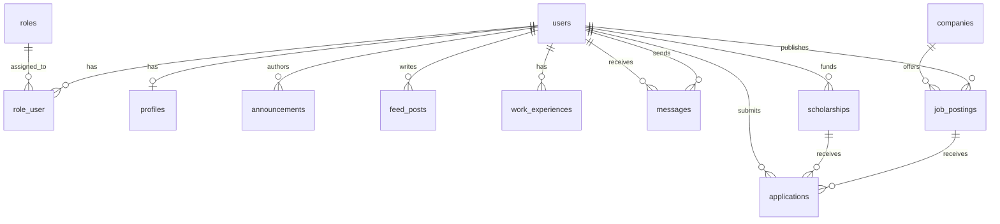

# Data Design Documentation

Physical data model of the Alumni Tracking System. It covers both implementations:

- **Laravel app** (`AlumniLaravel/`): MySQL 8, InnoDB, managed by migrations in `database/migrations`.
- **Node.js app** (`Alumni/`): PostgreSQL 16 plus a JSON user store, managed by `data/migrations` and `config/db.js`.

Primary keys are auto-increment integers. Laravel tables carry `created_at` / `updated_at`.

---

## 1. Laravel / MySQL Schema

All foreign keys use `ON DELETE CASCADE` (or `SET NULL` for company association).

### 1.1 `roles` (`database/migrations/2026_10_21_000003_create_roles_and_role_user_tables.php`)
| Column | Type | Constraints | Description |
|--------|------|-------------|-------------|
| `id` | BIGINT UNSIGNED | PK | Role ID |
| `name` | VARCHAR(255) | NN, UQ | Machine name: `admin`, `alumni`, `company`, `student` |
| `display_name` | VARCHAR(255) | NN | Human label: `Yönetici`, `Mezun`, `Şirket Temsilcisi`, `Öğrenci` |
| `description` | VARCHAR(255) | N | Description |
| `created_at` / `updated_at` | TIMESTAMP | NN | Timestamps |

### 1.2 `role_user` (Many-to-Many Pivot)
| Column | Type | Constraints | Description |
|--------|------|-------------|-------------|
| `id` | BIGINT UNSIGNED | PK | Pivot row ID |
| `user_id` | BIGINT UNSIGNED | FK → `users.id`, NN, CASCADE | User |
| `role_id` | BIGINT UNSIGNED | FK → `roles.id`, NN, CASCADE | Assigned Role |
| `created_at` / `updated_at` | TIMESTAMP | NN | Assignment timestamp |

Constraints: UNIQUE `(user_id, role_id)`.

### 1.3 `companies` (`database/migrations/2026_10_21_000004_create_companies_table.php`)
| Column | Type | Constraints | Description |
|--------|------|-------------|-------------|
| `id` | BIGINT UNSIGNED | PK | Company ID |
| `user_id` | BIGINT UNSIGNED | FK → `users.id`, N, NULL ON DELETE | Representative / Owner user |
| `name` | VARCHAR(255) | NN | Registered Company Name |
| `industry` | VARCHAR(255) | N | Sector / Industry |
| `website` | VARCHAR(255) | N | Official Website URL |
| `email` | VARCHAR(255) | N | Official Company Email |
| `phone` | VARCHAR(30) | N | Phone Number |
| `city` | VARCHAR(100) | N | City Location |
| `address` | VARCHAR(255) | N | Street Address |
| `description` | TEXT | N | Company Overview |
| `created_at` / `updated_at` | TIMESTAMP | NN | Timestamps |

### 1.4 `users`
| Column | Type | Constraints |
|--------|------|-------------|
| `id` | BIGINT UNSIGNED | PK |
| `name` | VARCHAR(255) | NOT NULL |
| `email` | VARCHAR(255) | NOT NULL, UNIQUE |
| `email_verified_at` | TIMESTAMP | NULL |
| `password` | VARCHAR(255) | NOT NULL (hashed) |
| `role` | VARCHAR(30) | NOT NULL, default `student`, indexed (`admin`, `alumni`, `company`, `student`) |
| `remember_token` | VARCHAR(100) | NULL |

Framework tables: `password_reset_tokens`, `sessions`, `cache`, `jobs`.

### 1.5 `profiles`
| Column | Type | Constraints |
|--------|------|-------------|
| `id` | BIGINT UNSIGNED | PK |
| `user_id` | BIGINT UNSIGNED | FK → `users.id`, UNIQUE (one profile per user) |
| `graduation_year` | INT | NOT NULL |
| `department` | VARCHAR(255) | NOT NULL |
| `bio` | TEXT | NULL |

### 1.6 `announcements`
| Column | Type | Constraints |
|--------|------|-------------|
| `id` | BIGINT UNSIGNED | PK |
| `user_id` | BIGINT UNSIGNED | FK → `users.id`; validated to be an `alumni` user |
| `title` | VARCHAR(255) | NOT NULL |
| `content` | TEXT | NOT NULL |
| `company_name` | VARCHAR(255) | NULL |

### 1.7 `feed_posts`
| Column | Type | Constraints |
|--------|------|-------------|
| `id` | BIGINT UNSIGNED | PK |
| `user_id` | BIGINT UNSIGNED | FK → `users.id` |
| `body` | TEXT | NOT NULL (validated 2–5000 characters) |
| `image_path` | VARCHAR(255) | NULL (validated as URL) |

### 1.8 `work_experiences`
| Column | Type | Constraints |
|--------|------|-------------|
| `id` | BIGINT UNSIGNED | PK |
| `user_id` | BIGINT UNSIGNED | FK → `users.id` |
| `company` | VARCHAR(255) | NOT NULL |
| `position` | VARCHAR(255) | NOT NULL |
| `latitude` | DECIMAL(10,8) | NOT NULL (−90 to 90) |
| `longitude` | DECIMAL(11,8) | NOT NULL (−180 to 180) |

### 1.9 `messages`
| Column | Type | Constraints |
|--------|------|-------------|
| `id` | BIGINT UNSIGNED | PK |
| `sender_id` | BIGINT UNSIGNED | FK → `users.id` |
| `receiver_id` | BIGINT UNSIGNED | FK → `users.id` |
| `content` | TEXT | NOT NULL |
| `read_at` | TIMESTAMP | NULL (unread when NULL) |

Index: `(receiver_id, read_at)` for unread-message lookups.

### 1.10 `job_postings` (`database/migrations/2026_10_21_000001_create_job_postings_table.php`)
| Column | Type | Constraints | Description |
|--------|------|-------------|-------------|
| `id` | BIGINT UNSIGNED | PK | Primary key |
| `user_id` | BIGINT UNSIGNED | FK → `users.id`, NN | Author/publisher (`alumni`, `company`, or `admin`) |
| `company_id` | BIGINT UNSIGNED | FK → `companies.id`, N, NULL ON DELETE | Associated company profile (One-to-Many) |
| `title` | VARCHAR(255) | NN | Job title |
| `description` | TEXT | NN | Detailed position description & qualifications |
| `company_name` | VARCHAR(255) | NN | Hiring company / institution name |
| `city` | VARCHAR(255) | N | Work city |
| `country` | VARCHAR(2) | N | Two-letter ISO country code (e.g. `TR`, `DE`) |
| `employment_type` | ENUM | NN | `full_time`, `part_time`, `internship`, `volunteer`, `project`, `contract` |
| `work_mode` | ENUM | NN, default `onsite` | `onsite`, `remote`, `hybrid` |
| `experience_level` | ENUM | N | `entry`, `mid`, `senior` |
| `required_skills` | TEXT | N | Comma-separated or bullet list of required skills |
| `contact_email` | VARCHAR(255) | N | Direct HR or alumni contact email |
| `external_application_link` | VARCHAR(500) | N | External portal URL. If set, applicants are redirected externally; if NULL, internal `applications` are used. |
| `application_deadline` | DATE | N | Application closing date |
| `status` | ENUM | NN, default `open` | `open`, `closed` |
| `latitude` | DECIMAL(10,8) | N | Latitude for career map rendering (−90 to 90) |
| `longitude` | DECIMAL(11,8) | N | Longitude for career map rendering (−180 to 180) |
| `created_at` / `updated_at` | TIMESTAMP | NN | Timestamps |

Indexes: `(status, application_deadline)`, `(employment_type)`.

### 1.11 `applications` (`database/migrations/2026_10_21_000002_create_applications_table.php`)
Used when `external_application_link` is NULL. Supports jobs, internships, volunteer positions, projects, and scholarships.

| Column | Type | Constraints | Description |
|--------|------|-------------|-------------|
| `id` | BIGINT UNSIGNED | PK | Primary key |
| `job_posting_id` | BIGINT UNSIGNED | FK → `job_postings.id`, N, CASCADE | Associated job/internship/project posting |
| `scholarship_id` | BIGINT UNSIGNED | FK → `scholarships.id`, N, CASCADE | Associated scholarship opportunity |
| `user_id` | BIGINT UNSIGNED | FK → `users.id`, NN, CASCADE | Candidate / student / applicant user |
| `type` | ENUM | NN, default `job` | `job`, `internship`, `volunteer`, `project`, `scholarship` |
| `cover_letter` | TEXT | N | Optional motivation / cover letter / statement of need |
| `status` | ENUM | NN, default `pending` | `pending`, `submitted`, `reviewing`, `accepted`, `rejected` |
| `created_at` / `updated_at` | TIMESTAMP | NN | Timestamps |

Constraints: UNIQUE `(job_posting_id, user_id)` and UNIQUE `(scholarship_id, user_id)`.

### 1.12 `scholarships` (`database/migrations/2026_10_21_000005_create_scholarships_table.php`)
Scholarship opportunities created by alumni donors, foundations, or administrators.

| Column | Type | Constraints | Description |
|--------|------|-------------|-------------|
| `id` | BIGINT UNSIGNED | PK | Primary key |
| `user_id` | BIGINT UNSIGNED | FK → `users.id`, NN, CASCADE | Author / funding alumnus or admin |
| `title` | VARCHAR(255) | NN | Scholarship program title |
| `description` | TEXT | NN | Detailed grant terms and purpose |
| `donor_name` | VARCHAR(255) | N | Visible donor name if non-anonymous |
| `is_anonymous` | BOOLEAN | NN, default `false` | Anonymity preference. If `true`, display name defaults to 'Anonim Mezun' |
| `amount` | DECIMAL(10,2) | N | Financial stipend amount |
| `currency` | VARCHAR(3) | NN, default `TRY` | Currency code |
| `duration` | VARCHAR(100) | N | Grant duration (e.g. '9 Ay', '1 Yıl', 'Tek Seferlik') |
| `quota` | INT UNSIGNED | N | Number of recipient students |
| `requirements` | TEXT | N | Eligibility conditions (minimum GPA, department, financial need) |
| `contact_email` | VARCHAR(255) | N | Direct contact email |
| `external_application_link` | VARCHAR(500) | N | External foundation URL (e.g. TEV, KYK). If set, redirects externally; if NULL, internal `applications` are used. |
| `application_deadline` | DATE | N | Application closing date |
| `status` | ENUM | NN, default `open` | `open`, `closed` |
| `created_at` / `updated_at` | TIMESTAMP | NN | Timestamps |

Indexes: `(status, application_deadline)`, `(is_anonymous)`.

#### 1.12.1 Hybrid Application Flow & Anonymity Logic
- **Routing Decision**:
  - `external_application_link != NULL`: The applicant is directly redirected to the foundation/institution's external portal.
  - `external_application_link == NULL`: Student applies directly inside the platform; stored in `applications` (`type: scholarship`).
- **Donor Anonymity**:
  - If `is_anonymous == true`: Public views display 'Anonim Mezun' as the grantor.
  - In the donor's private portal: The donor or Admin can view and review all applicant students and evaluate their cover letters.

### 1.13 Business Rules & Authorization
| Rule | Enforced by |
|------|-------------|
| Only `alumni`, `company`, or `admin` users may author job postings and scholarships | Controller validation & Policies (`JobPostingPolicy`, `ScholarshipPolicy`) |
| Hybrid application routing | If `external_application_link` is present, applicant is redirected externally; if NULL, internal submission is stored in `applications` |
| Candidate internal application permissions | Only `student`, `alumni`, and `admin` roles can submit internal applications (`ApplicationPolicy@create`) |
| Application visibility | Candidates can only view their own applications; posting authors and admins can view candidate lists (`ApplicationPolicy@view`) |
| Application status management | Only job posting / scholarship author or admin can update status (`ApplicationPolicy@update`) |
| Application withdrawal | Candidates can withdraw an application while status is `pending`/`submitted` (`ApplicationPolicy@delete`) |
| Donor anonymity enforcement | `Scholarship::getDonorDisplayNameAttribute()` automatically masks donor names when `is_anonymous` is true |
| One profile per user | UNIQUE `profiles.user_id` |
| One application per user per posting/scholarship | UNIQUE `(job_posting_id, user_id)` & UNIQUE `(scholarship_id, user_id)` |
| Foreign key cascade | FK `ON DELETE CASCADE` on `job_posting_id`, `scholarship_id`, and `user_id` |

---

## 2. Node.js / PostgreSQL Schema

### 2.1 `alumni` (`data/migrations/001_create_alumni_table.js`)
| Column | Type | Constraints |
|--------|------|-------------|
| `id` | SERIAL | PK |
| `first_name` | VARCHAR(100) | NOT NULL |
| `last_name` | VARCHAR(100) | NOT NULL |
| `email` | VARCHAR(255) | NOT NULL, UNIQUE |
| `phone` | VARCHAR(30) | NULL |
| `graduation_year` | SMALLINT | NOT NULL, CHECK 1950–2100 |
| `department` | VARCHAR(150) | NOT NULL |
| `current_company` | VARCHAR(150) | NULL |
| `job_title` | VARCHAR(150) | NULL |
| `city` | VARCHAR(100) | NULL |
| `linkedin_url` | VARCHAR(255) | NULL |
| `created_at` | TIMESTAMPTZ | NOT NULL, default `NOW()` |
| `updated_at` | TIMESTAMPTZ | NULL |

Indexes: `idx_alumni_graduation_year`, `idx_alumni_department`.

### 2.2 `announcements` (created in `config/db.js`)
| Column | Type | Constraints |
|--------|------|-------------|
| `id` | SERIAL | PK |
| `title` | VARCHAR(255) | NOT NULL |
| `content` | TEXT | NOT NULL |
| `created_at` | TIMESTAMPTZ | default `NOW()` |
| `updated_at` | TIMESTAMPTZ | NULL |

### 2.3 `job_postings` (`data/migrations/002_create_job_postings_tables.js`)
| Column | Type | Constraints | Description |
|--------|------|-------------|-------------|
| `id` | SERIAL | PK | Primary key |
| `alumni_id` | INTEGER | FK → `alumni(id)` ON DELETE CASCADE, NN | Author alumnus |
| `title` | VARCHAR(255) | NN | Job title |
| `description` | TEXT | NN | Detailed job description |
| `company_name` | VARCHAR(255) | NN | Company name |
| `city` | VARCHAR(100) | N | Location city |
| `country` | CHAR(2) | N | ISO country code |
| `employment_type` | VARCHAR(20) | NN, CHECK `in ('full_time','part_time','internship','contract')` | Work type |
| `work_mode` | VARCHAR(10) | NN, default `'onsite'`, CHECK `in ('onsite','remote','hybrid')` | Work model |
| `experience_level` | VARCHAR(10) | N, CHECK `in ('entry','mid','senior')` | Seniority level |
| `required_skills` | TEXT | N | Required tech stack / skills |
| `contact_email` | VARCHAR(255) | N | Contact email |
| `external_application_link` | VARCHAR(500) | N | External redirect URL (nullable) |
| `application_deadline` | DATE | N | Deadline date |
| `status` | VARCHAR(10) | NN, default `'open'`, CHECK `in ('open','closed')` | Posting status |
| `latitude` | NUMERIC(10,8) | N, CHECK between -90 and 90 | Map latitude |
| `longitude` | NUMERIC(11,8) | N, CHECK between -180 and 180 | Map longitude |
| `created_at` | TIMESTAMPTZ | NN, default `NOW()` | Creation timestamp |
| `updated_at` | TIMESTAMPTZ | N | Update timestamp |

Indexes: `idx_job_postings_status_deadline`, `idx_job_postings_employment_type`.

### 2.4 `applications` (`data/migrations/002_create_job_postings_tables.js` & `003_create_scholarships_tables.js`)
| Column | Type | Constraints | Description |
|--------|------|-------------|-------------|
| `id` | SERIAL | PK | Primary key |
| `job_posting_id` | INTEGER | FK → `job_postings(id)` ON DELETE CASCADE, N | Target job/project |
| `scholarship_id` | INTEGER | FK → `scholarships(id)` ON DELETE CASCADE, N | Target scholarship |
| `applicant_user_id` | INTEGER | NN | Applicant ID (from `data/users.json`) |
| `type` | VARCHAR(20) | NN, default `'job'`, CHECK `in ('job','internship','volunteer','project','scholarship')` | Application category |
| `cover_letter` | TEXT | N | Candidate note |
| `status` | VARCHAR(15) | NN, default `'pending'`, CHECK `in ('pending','submitted','reviewing','accepted','rejected')` | Application progress |
| `created_at` | TIMESTAMPTZ | NN, default `NOW()` | Submission timestamp |
| `updated_at` | TIMESTAMPTZ | N | Timestamp |

Constraints: UNIQUE `(job_posting_id, applicant_user_id)` and UNIQUE `(scholarship_id, applicant_user_id)`.

### 2.5 `scholarships` (`data/migrations/003_create_scholarships_tables.js`)
| Column | Type | Constraints | Description |
|--------|------|-------------|-------------|
| `id` | SERIAL | PK | Primary key |
| `alumni_id` | INTEGER | FK → `alumni(id)` ON DELETE CASCADE, NN | Sponsoring alumnus |
| `title` | VARCHAR(255) | NN | Program title |
| `description` | TEXT | NN | Program terms |
| `donor_name` | VARCHAR(255) | N | Donor public label |
| `is_anonymous` | BOOLEAN | NN, default `false` | Anonymity indicator |
| `amount` | NUMERIC(10,2) | N | Financial stipend |
| `currency` | CHAR(3) | NN, default `'TRY'` | Currency code |
| `duration` | VARCHAR(100) | N | Duration string |
| `quota` | INTEGER | N | Student quota |
| `requirements` | TEXT | N | Eligibility terms |
| `contact_email` | VARCHAR(255) | N | Contact email |
| `external_application_link` | VARCHAR(500) | N | External foundation URL |
| `application_deadline` | DATE | N | Deadline date |
| `status` | VARCHAR(10) | NN, default `'open'`, CHECK `in ('open','closed')` | Program status |
| `created_at` | TIMESTAMPTZ | NN, default `NOW()` | Creation timestamp |
| `updated_at` | TIMESTAMPTZ | N | Timestamp |

### 2.6 Users (`data/users.json`)
JSON array of `{ id, name, email, passwordHash, createdAt, updatedAt? }`. `passwordHash` is `salt:hash` (PBKDF2-SHA512, 1000 iterations); it is never returned by the API.

---

## 3. Naming and Conventions
- Tables: plural `snake_case`; foreign keys: `<singular>_id`.
- API fields are `camelCase` (`employmentType`, `companyName`, `applicationDeadline`); the repository layer maps them to `snake_case` database columns.
- Passwords are stored only as salted hashes.
